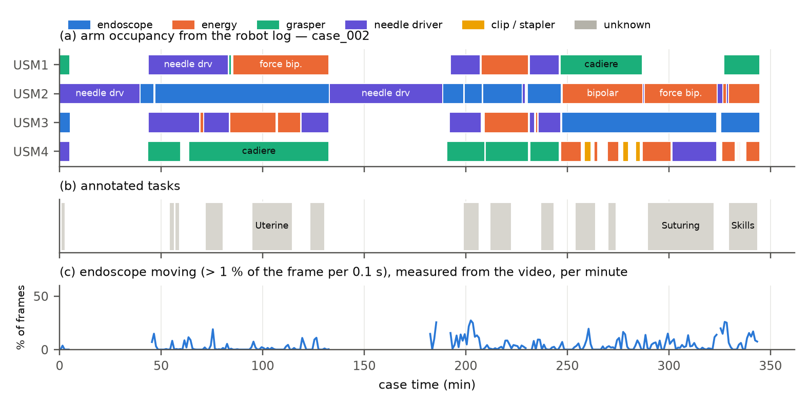

# Surgical World Model (EG-SWM)

**Embodiment-grounded world models of robot-assisted surgery.** Given a few endoscope frames and an action, the model predicts the next seconds of surgical video. Its action space mirrors the robot: an explicit **endoscope ego-motion** action plus one latent action per **instrument arm**, learned from unlabeled in-vivo da Vinci video and bound to the arms through the robot's own system logs — no kinematics needed. Target venue: *IEEE Transactions on Medical Robotics and Bionics*; early showcase at NBRCOM-2026 (AIIMS Nagpur).

* Weights (public, CC BY-NC-SA 4.0): <https://huggingface.co/GOVINDFROM/surgical-world-model>
* Research documents: [data audit](docs/01_data_audit.md) · [external data](docs/02_external_data.md) · [literature review](docs/03_literature_review.md) · [research plan](docs/04_research_plan.md) · [legacy](docs/legacy.md)

## Status (updated 2026-10-27, 22:00 IST)

| Stage | State |
|---|---|
| Data audit, literature review, hypotheses, case-level split, tokenizer choice | done |
| Model, 7 action interfaces, kinematics-conditioned mode, SurgWM re-implementation, evaluation suite, result aggregation | done |
| SurgVU processing (10 fps cache → Wan2.2 latents → detection → arm binding → console readout) | running as systemd user services (`scripts/run_services.sh`); 10 fps cache done (280/280 parts), latents 58 % (expected complete ≈ 10:00 on 28 Oct), detection/arm binding following |
| External preparation (SutureBot → CRCD → JIGSAWS → SAR-RARP50) | SutureBot and CRCD done and sync-checked; JIGSAWS, SAR-RARP50 and SRT-H (14,836 episodes) run next to training (`swm-external`) once SurgVU encoding ends |
| Camera-action validation on CRCD (E2b) | done — see results below |
| Open-H SRT-H download | done (preparation queued); AutoLaparo server unreachable from this network |
| Pilot (S, partial data) | diffusion loss only: learned arm actions collapse; with the forward-decoder objective all 8 action dimensions are used and action replay is 12 % more accurate (below). Global-action pilot and a no-decoder control on the same parts run until ≈ 03:30 |
| Reference evaluation → 9 controlled runs → 4 grounding/readout/objective ablations | queued; starts automatically when data is complete |
| Manuscript | draft in `paper/tmrb`; results tables generated by `scripts/eval/aggregate.py` |

Results tables appear in [docs/results/](docs/results/) as runs finish.

## Experiments and evaluation protocol

| ID | Question | Data | Script |
|---|---|---|---|
| E1 | fidelity and controllability of each action interface at equal capacity | SurgVU, 2,000 fixed held-out windows from 20 test cases | `scripts/eval/eval_wm.py`, `scripts/eval/eval_control.py` |
| E2 | do learned per-arm actions encode real robot motion? | SutureBot, CRCD, JIGSAWS (held-out episodes / surgeons) | `scripts/eval/probe_kinematics.py` |
| E2b | does the explicit camera action measure real endoscope motion? | CRCD (ECM joints, camera pedal) | `scripts/eval/validate_camera_action.py` |
| E3 | kinematics-conditioned prediction, data efficiency of unlabeled pre-training | SutureBot, SRT-H, CRCD | `scripts/train/train_wm.py --action kin --init <run>` |
| E4 | transfer to clinical surgery | SAR-RARP50 | — |
| E6 | ablations (action structure, camera, grounding, bottleneck, tokenizer, data and model scale) | SurgVU | `scripts/train/train_wm.py` |

Metrics: PSNR / SSIM / LPIPS per predicted frame against **real** frames (not VAE reconstructions), FVD with the StyleGAN-V I3D port, ΔPSNR under swapped actions, endoscope compliance (commanded vs re-estimated motion), per-arm locality of action changes, embodiment consistency (instrument detector on generated frames vs the robot's logged instruments), and linear-probe R² against kinematics. Reference rows: repeat-last-context-frame and VAE reconstruction.

Compared action interfaces, all sharing tokenizer, backbone, data and budget: `none`, `state` (robot state only), `global` (monolithic continuous latent action, Genie-style), `global_vq` (12 discrete actions, SurgWM-style), `slots` (unsupervised factors, FLAM-style), `arms` (**EG-SWM**), each with or without the explicit camera action; plus the full SurgWM re-implementation and, on kinematic benchmarks, Cosmos-H-Surgical-Simulator.

## Overview

### Data pipeline


*One decode pass turns 837.8 h of 720p60 da Vinci video into a 10 fps cache (640×512, visually lossless) and, per frame, quality flags and the endoscope's ego-motion. Robot-side signals — the system logs' arm occupancy (which arm holds the endoscope and which instrument sits on every other arm) and the console overlay burned into the video (driving hand, energy) — bind detected instruments to robot arms. The world model sees only the 224×320 endoscope field, never the overlay, so it cannot read instrument names off the screen.*

### Model


*Sample input/output from a held-out test case (`case_139`, suturing; frames 0.4 s apart). Until the first model is trained, the output row shows the ground-truth future of that window; it will be replaced by model rollouts on the same window. Frames: SurgVU dataset (Zia et al., 2025), endoscope field only.*

**Tokenizer.** A frozen Wan2.2 video VAE compresses 4 frames into one latent $z_t\in\mathbb{R}^{48\times14\times20}$; a 3.3 s training window (33 frames at 10 fps) becomes 9 latents.

**Actions.** For each latent step the action is $a_t=(c_t,\{u^k_t\}_k)$:
* $c_t=(\Delta x,\Delta y,\log s,\theta)$ — endoscope ego-motion, *measured* (Lucas–Kanade tracks + RANSAC similarity, instruments rejected as outliers) for each of the 4 frame transitions in a latent step, plus a validity flag per transition so that "not measured" is never read as "endoscope still". It enters every transformer sub-layer through AdaLN.
* $u^k_t$ — a low-dimensional *learned* action for instrument arm $k$, produced during training by an inverse-dynamics head that only sees the latents inside that arm's region $R^k_t$ (instrument detector + tracker, detections bound to arms through the robot log) and is regularised by a KL bottleneck (β = 10⁻⁴). A small convolutional *forward decoder* must predict each latent from its predecessor, $c_t$ and the arm actions written into their regions (latent-action-model objective, as in Genie/LAPA/AdaWorld but grounded); without it the actions collapse — see the pilot below. Each arm becomes a token (action + arm id + instrument + driving hand) that the video tokens cross-attend to.

**Dynamics.** A latent spatio-temporal diffusion transformer (spatial self-attention per frame, causal temporal self-attention, cross-attention to arm tokens, MLP) trained with flow matching and per-frame noise levels (diffusion forcing), so it can roll out autoregressively from any number of context frames.

**Training objective.** Flow matching + λ·forward-decoder loss + β·KL (λ = 1, β = 10⁻⁴ ramped up over 10k steps); actions are dropped with probability 0.1 for classifier-free guidance. The inverse-dynamics head and the forward decoder are used only in training; at inference the actions are inferred from a real clip (*replay*), taken from another clip (*swap*) or set directly.

| Size | width × depth (heads) | parameters | of which transformer / inverse dynamics / forward decoder |
|---|---|---:|---|
| S | 512 × 8 (8) | 50.1 M | 45.5 M / 2.0 M / 2.0 M |
| B | 768 × 12 (12) | 153.7 M | 148.2 M / 2.0 M / 2.0 M |
| L | 1024 × 16 (16) | 354.8 M | 348.4 M / 2.0 M / 2.0 M |

**Why.** A single latent action (Genie, SurgWM) has to explain camera motion, two or three instruments and tissue response at once; LAOM (ICML 2025) shows such latents collapse under action-correlated distractors unless a little supervision is added. The robot already tells us its embodiment for free — we use it to structure, not just supervise, the action space. Hypotheses H1–H4 and the experiment plan are in [docs/04_research_plan.md](docs/04_research_plan.md).

## Results so far

### Tokenizer selection (64 held-out validation clips × 9 frames, 224×320)

| Tokenizer | Type | Latent numbers / frame | PSNR ↑ | SSIM ↑ | LPIPS ↓ |
|---|---|---:|---:|---:|---:|
| FLUX.2 VAE | image, f8, 32 ch | 35,840 | **38.40** | **0.975** | **0.007** |
| **Wan2.2 VAE (chosen)** | video, f16, ×4 time, 48 ch | **4,480** | 34.44 | 0.947 | 0.019 |
| Wan2.1 VAE | video, f8, ×4 time, 16 ch | 5,973 | 34.13 | 0.947 | 0.020 |
| SD-VAE (ft-MSE) | image, f8, 4 ch | 4,480 | 28.85 | 0.829 | 0.057 |
| DC-AE | image, f32, 32 ch | 2,240 | 26.15 | 0.738 | 0.090 |

Wan2.2 gives the best quality per latent number (8× more compact than FLUX.2 at 34.4 dB, far above the PSNR any predicted frame reaches) and temporally coherent decoding; FLUX.2 is kept as the per-frame tokenizer ablation. Reproduce: `python scripts/eval/tokenizer_bench.py`.

### Pilot — learned actions collapse under the diffusion loss alone (S, 12k steps, partial SurgVU)

The first pilot trained EG-SWM with the flow-matching loss and the KL bottleneck only. The arm actions carried information early (KL 1.4 nats/arm at step 1.5k) and then collapsed to the prior as the KL weight ramped up (`scripts/eval/diagnose_actions.py` on validation windows: 64 at step 6k, 256 at 12k):

| | step 6k | step 12k |
|---|---:|---:|
| active action dimensions (Var E[u\|x] > 0.01) | 1 / 8 | 0 / 8 |
| KL per arm (nats) | 0.32 | 0.004 |
| loss change when every arm's action is taken from another window | +0.03 to +0.09 % | ≤ +0.002 % |
| loss change when the endoscope action is taken from another window | +0.1 to +4.1 % | +0.1 to +14 % |

The explicit camera action is used; the learned arm actions are not. The fix is a latent-action-model objective (forward decoder, above) and a weaker bottleneck (β 10⁻³ → 10⁻⁴), applied identically to every learned-action baseline; `S_arms_nofwd` keeps the old objective as an ablation.

**With the forward decoder** (second pilot, same size and schedule). Both pilots at step 12k on the same 256 validation windows. *Replay* generates the 7 future latents from 2 context latents (10 Euler steps, same noise for every row) with the actions inferred from the real clip, and reports the mean squared error to the real latents:

| step 12k, same windows | diffusion loss only | + forward decoder |
|---|---:|---:|
| active action dimensions | 0 / 8 | **8 / 8** |
| KL per arm (nats) | 0.004 | 14.2 |
| replay error, own actions — all positions | 0.609 | **0.534** (−12 %) |
| replay error, own actions — inside instrument regions | 0.734 | **0.584** (−20 %) |
| replay error increase, arm actions of another window | +0.001 % | **+10.7 %** (+20 % inside regions) |
| replay error increase, endoscope action of another window | +7.1 % | +8.2 % |
| flow-matching error at τ = 0.9 inside regions, own actions | 0.342 | **0.293** |
| its increase with another window's arm actions (inside / outside regions) | +0.001 / +0.003 % | +34 / +13 % |

The decoder makes the arm actions informative, the diffusion model then relies on them (most of all inside the instrument regions, where they are written), and futures replayed from them are more accurate, without losing the use of the endoscope action. The second pilot also used β = 10⁻⁴ and 18 % more training windows (213,985 vs 181,585; the partial set was growing); a no-decoder pilot at β = 10⁻⁴ and a monolithic-action pilot, both on exactly the second pilot's parts (`configs/splits/surgvu_pilot_parts.json`), separate these factors before the controlled comparisons.

### E2b — the camera action measures real endoscope motion (CRCD, dVRK ECM kinematics)

| | value |
|---|---:|
| detection of real endoscope motion (ECM moving), ROC AUC per latent step | **0.81** |
| — on steps whose 4 transitions were all estimated reliably (72 % of steps) | **0.88** |
| correlation dx ↔ ECM yaw / dy ↔ pitch / log s ↔ insertion | 0.63 / 0.70 / 0.42 |
| sign agreement on the same pairs (larger half of moves) | 81 % / 87 % / 73 % |
| leave-one-episode-out R², ECM joint motion → ego-motion | 0.41 |

Measured on 11 of 18 CRCD episodes (2,616 windows). **The public LeRobot conversion of CRCD is not in sync in 7 episodes**: three are offset by a constant 1.2 s (corrected), the rest drift (episode 6: 0.6 s per minute) or never lock (excluded). Without this check the same estimator scores R² ≈ 0.01 — misalignment, not estimation error. The lag is measured from VAE-latent change vs arm motion, independently of the ego-motion estimator (`scripts/data/check_sync.py`); every kinematics-based analysis uses synced windows only. SutureBot is in sync. The camera pedal is a weaker label (the ECM is still in 39 % of pedal-pressed transitions). Reproduce: `python scripts/data/check_sync.py crcd && python scripts/eval/validate_camera_action.py --data crcd`.

### Data facts that shape the method ([full audit](docs/01_data_audit.md))



*One training case on one time axis: (a) which arm holds the endoscope and which instrument sits on every other arm, from the system log alone; (b) annotated tasks; (c) endoscope motion measured from the video. The endoscope changes ports and instruments are exchanged throughout.*


* 155 cases, 280 videos, 837.8 h, all decodable; ≈604 h usable (23 % black, 4.5 % out of body / smoke, 1.7 % fluorescence).
* The system logs record all four arms **including the endoscope**; the endoscope moves between ports during most cases (211 port changes in 104 of 155 cases; USM2 holds it most of the time in 142 cases). Three instruments are mounted 65 % of the time; 5,969 instrument exchanges (7.1 / h).
* Log times are part-relative (`swm.data.surgvu.timeline` handles offsets); 97 % of same-arm overlaps are stale intervals from missing uninstall events.
* The console overlay is present on 81 % of usable frames and shows which hand drives which arm and when energy fires.

## Datasets

| Dataset | Role | Access | Local status |
|---|---|---|---|
| SurgVU (Intuitive) | training + main benchmark | public | `data/raw/surgvu*` |
| Open-H-Embodiment: SutureBot, SRT-H porcine cholecystectomy, CRCD | kinematic grounding, kinematics-conditioned benchmarks | CC-BY-4.0 | SutureBot, CRCD prepared and sync-checked; SRT-H downloaded (107 GB), prepared after SurgVU encoding |
| JIGSAWS | kinematic grounding (da Vinci) | data-use agreement | downloaded; prepared after SurgVU encoding |
| SAR-RARP50 | clinical (human) transfer | CC BY-NC-SA 4.0 | downloaded (32 GB); prepared after SurgVU encoding |
| AutoLaparo | external test of the camera action (laparoscope motion labels) | request form | pending (server unreachable) |

PhysioNet holds no surgical video with robot kinematics, so nothing is taken from it ([details](docs/02_external_data.md)).

## Repository layout

```text
src/swm/                  package
  paths.py                canonical data / checkpoint / output locations
  data/surgvu.py          robot-log labels on a global case timeline, arm occupancy, tasks
  data/geometry.py        crops shared by every stage (source -> cache -> endoscope field)
  data/egomotion.py       endoscope ego-motion (LK + RANSAC similarity)
  data/windows.py         SurgVU latent windows (robot state, arm boxes, camera actions)
  data/external.py        external datasets with kinematics; data/kinematics.py per-arm motion
  data/sync.py            video-kinematics lag of the external datasets
  data/io.py              atomic writes / tolerant reads between pipeline stages
  models/layers.py        RMSNorm, rotary embeddings, attention, SwiGLU, AdaLN
  models/dynamics.py      spatio-temporal diffusion transformer (sizes S / B / L)
  models/actions.py       action interfaces: camera encoder, arm tokens, inverse dynamics (arms, global,
                          VQ, slots), forward decoder
  models/world_model.py   world model: action inference, losses, sampling
  baselines/surgwm.py     re-implementation of the Surgical Vision World Model
  metrics/                PSNR / SSIM / LPIPS (image.py), FVD (fvd.py)
  hub.py                  Hugging Face upload (token from .env, never printed)
scripts/data/             audits, splits, downloads, 10 fps cache, latents, instrument detection, arm binding,
                          console readout, external-dataset preparation, sync check
scripts/train/            world-model and SurgWM training
scripts/eval/             tokenizer benchmark, evaluation sets, E1 fidelity / control, action-use diagnostics,
                          E2 probes, camera-action validation, result aggregation
scripts/queue/            sequential GPU job queue
scripts/run_services.sh   long-running pipeline stages as systemd user units
scripts/docs/             sample export, figures, TikZ diagram build, arXiv BibTeX
configs/experiments/      one shell script per queued job (see below)
configs/splits/           case-level split; parts used by the pilots
configs/stats/            camera-action normalisation
docs/                     research documents; docs/diagrams/*.tex -> docs/figures/*.{pdf,png}; docs/results/
paper/tmrb/               IEEE T-MRB manuscript (figures from docs/figures, tables from docs/results)
tests/                    unit tests
legacy/                   previous SurgVU 2026 Cat-1 detection project (reused detector)
data/ checkpoints/ outputs/ archive/   Git-ignored
```

## Setup and reproduction

```bash
uv venv --python 3.12 .venv
uv pip install --python .venv/bin/python torch torchvision --index-url https://download.pytorch.org/whl/cu130
uv pip install --python .venv/bin/python -e ".[dev]"
```

**Data.** The SurgVU stages poll each other's outputs, so they can run concurrently; `scripts/run_services.sh` starts them (and the GPU queue) as systemd user units that log to `outputs/logs/`.

```bash
python scripts/data/audit_surgvu.py --workers 20          # video integrity, label tables
python scripts/data/audit_timeline.py                     # robot configuration on the global timeline
python scripts/data/audit_frames.py --every 60            # frame quality, console-UI presence
python scripts/data/make_splits.py                        # case-level split
python scripts/data/build_surgvu_cache.py --workers 18    # 10 fps cache + quality + ego-motion
python scripts/data/encode_latents.py --wait              # Wan2.2 latents of every usable 33-frame window
python scripts/data/detect_instruments.py --wait          # instrument boxes at the latent-step boundaries
python scripts/data/build_conditioning.py --wait          # arm binding, arm regions, robot state, camera action
python scripts/data/ui_readout.py --wait                  # console overlay: driving hand, energy
python scripts/data/build_windows.py                      # window index, camera-action statistics
python scripts/eval/build_eval_set.py --split test --per-case 100   # fixed held-out windows + real frames
python scripts/data/download_external.py --list           # external datasets
python scripts/data/prepare_lerobot.py --name suturebot --root <dir>   # also prepare_jigsaws.py, prepare_sarrarp.py
python scripts/data/check_sync.py crcd                    # video-kinematics lag per episode
```

**Training and evaluation.**

```bash
python scripts/train/train_wm.py --name S_arms --action arms --size S --steps 60000
#   --action none|state|global|global_vq|slots|arms|kin, --no-camera, --fwd 0 (no forward decoder), --kl,
#   --arm-pool region|global|shuffled, --use-ui, --data <external>, --init <run>, --stems <parts.json>, --resume
python scripts/train/train_surgwm.py --stage tokenizer    # then --stage lam, --stage dynamics
python scripts/eval/eval_wm.py --run S_arms --fvd         # E1 fidelity against real frames (action replay)
python scripts/eval/eval_control.py --run S_arms          # E1 camera control, locality, embodiment consistency
python scripts/eval/diagnose_actions.py --run S_arms      # are the learned actions used? (collapse check)
python scripts/eval/probe_kinematics.py --data suturebot --runs S_arms S_global --baselines   # E2
python scripts/eval/validate_camera_action.py --data crcd # E2b
python scripts/eval/aggregate.py                          # docs/results/*.md, paper/tmrb/tables/*.tex
python scripts/eval/tokenizer_bench.py                    # tokenizer comparison
scripts/docs/build_diagrams.sh                            # TikZ -> PDF/PNG
```

**Job queue.** Every experiment is a shell script in `configs/experiments/`; copies in `outputs/queue/pending/` are run in name order by `scripts/queue/run_queue.py` (logs in `outputs/queue/logs/`, history in `outputs/queue/history.tsv`).

| Jobs | Content |
|---|---|
| 010, 020 | prepare SutureBot and CRCD (done) |
| 090, 091, 093, 094 | pilots on partial SurgVU (S, 12k steps): diffusion loss only, + forward decoder, monolithic action, no-decoder control at β = 10⁻⁴ |
| 100 | once all 280 parts are encoded: window index, camera statistics, fixed validation and test windows |
| 150 | reference rows (repeat last context frame, VAE reconstruction) |
| 200–280 | E1 at S (60k steps): `arms`, `global`, `global_vq`, `slots`, `state`, `none`; `arms`, `global`, `state` without the camera action |
| 300–320 | E6 ablations: pooling over the whole frame, no forward decoder, arm regions shuffled across arms, console readout in the arm tokens |
| 390–392 | prepare JIGSAWS, SAR-RARP50, SRT-H (`swm-external` service, next to training) |
| 400–450 | E2: zero-shot kinematic probes; action-free adaptation to SutureBot, CRCD, JIGSAWS; probes after adaptation |
| 500–508 | E3 on SutureBot: kinematics-conditioned prediction from scratch / from `S_arms` / from `S_global`, 10 / 25 / 100 % of the training episodes |

Raw SurgVU data comes from the organisers (`storage.googleapis.com/isi-surgvu/…`); links for data-use-agreement datasets live in the Git-ignored `configs/private/dataset_links.json`. A `.env` with `hf=<token>` and `HF_USER=<user>` enables weight uploads (`swm.hub.push_folder`).

## Citation of data

* A. Zia et al., "Surgical Visual Understanding (SurgVU) Dataset," arXiv:2501.09209, 2025.
* Y. Gao et al., "JHU-ISI Gesture and Skill Assessment Working Set (JIGSAWS): A Surgical Activity Dataset for Human Motion Modeling," MICCAI Workshop M2CAI, 2014 — <http://cirl.lcsr.jhu.edu/research/hmm/datasets/jigsaws_release>.
* Open-H-Embodiment Consortium, "Open-H-Embodiment: A Large-Scale Dataset for Enabling Foundation Models in Medical Robotics," arXiv:2604.21017, 2026.
* D. Psychogyios et al., "SAR-RARP50: Segmentation of surgical instrumentation and Action Recognition on Robot-Assisted Radical Prostatectomy Challenge," arXiv:2401.00496, 2023.
* Z. Wang et al., "AutoLaparo: A New Dataset of Integrated Multi-tasks for Image-guided Surgical Automation in Laparoscopic Hysterectomy," MICCAI 2022, arXiv:2208.02049.
* "Comprehensive Robotic Cholecystectomy Dataset (CRCD): Integrating Kinematics, Pedal Signals, and Endoscopic Videos," ISMR 2024, doi:10.1109/ISMR63436.2024.10585836.
