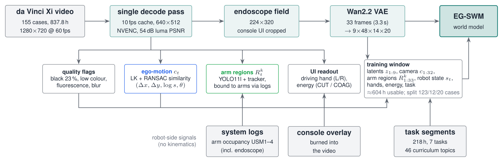
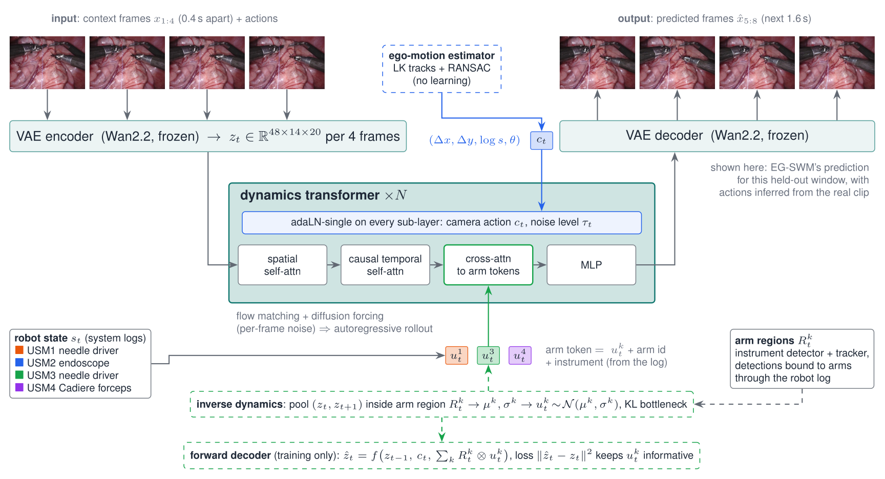
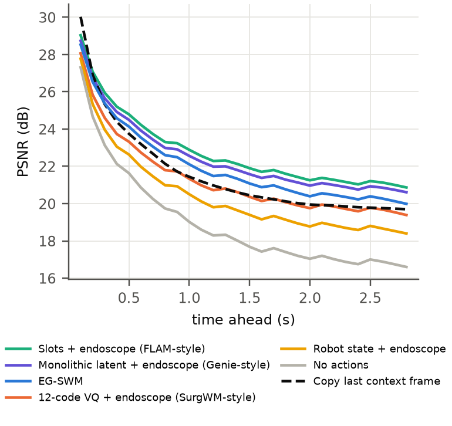
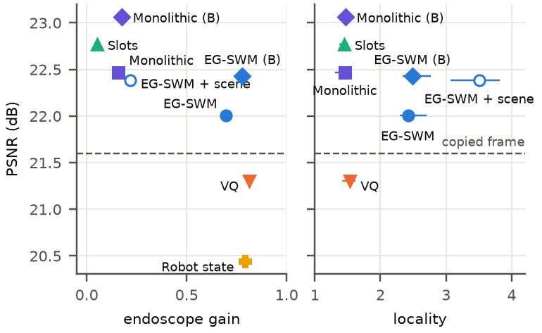
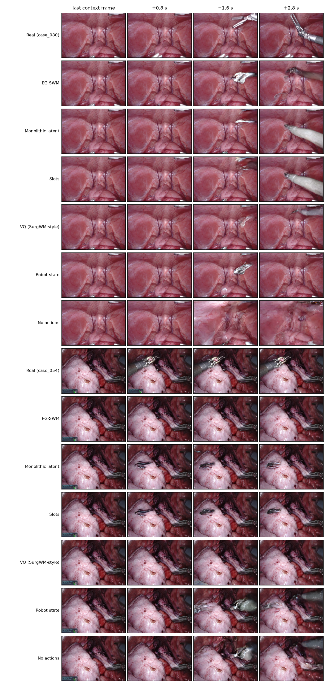
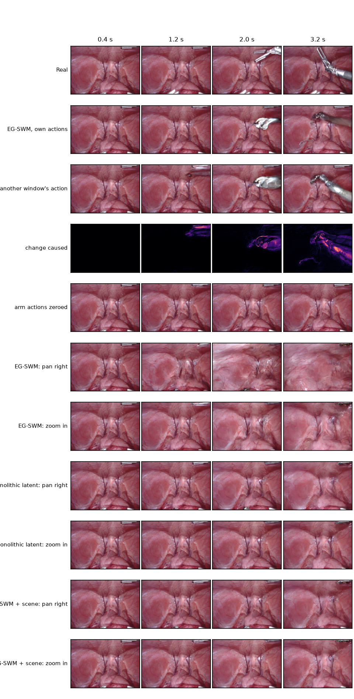
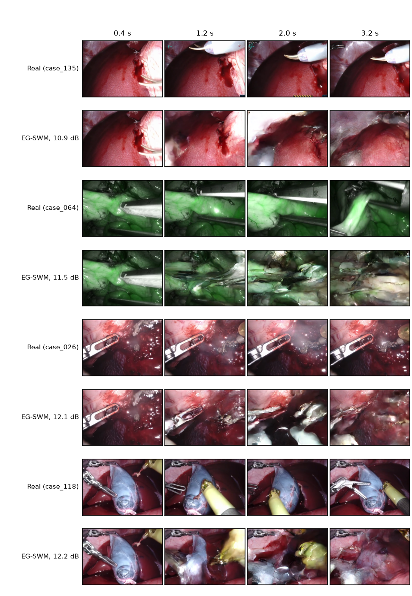
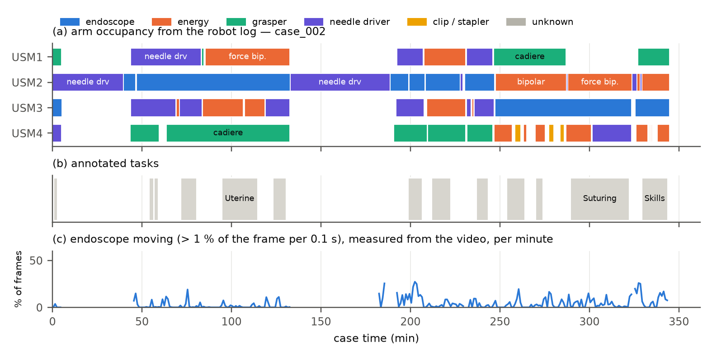

# Surgical World Model (EG-SWM)

**Embodiment-grounded world models of robot-assisted surgery.** Given a few endoscope frames and an action, the model predicts the next seconds of surgical video. Its action space mirrors the robot: an explicit **endoscope ego-motion** action plus one latent action per **instrument arm**, learned from unlabeled in-vivo da Vinci video and bound to the arms through the robot's own system logs — no kinematics needed. Target venue: *IEEE Transactions on Medical Robotics and Bionics*; early showcase at NBRCOM-2026 (AIIMS Nagpur).

* Weights (public, CC BY-NC-SA 4.0): <https://huggingface.co/GOVINDFROM/surgical-world-model> — one folder per finished run (EMA weights, config, evaluation summaries), published by each queue job
* Research documents: [data audit](docs/01_data_audit.md) · [external data](docs/02_external_data.md) · [literature review](docs/03_literature_review.md) · [research plan](docs/04_research_plan.md) · [legacy](docs/legacy.md)

## Status (updated 2026-11-06, 06:55 IST)

| Stage | State |
|---|---|
| Data audit, literature review, hypotheses, case-level split, tokenizer choice | done |
| Model, 7 action interfaces, kinematics-conditioned mode, SurgWM re-implementation and its evaluation, evaluation suite, result aggregation | done |
| SurgVU processing (10 fps cache → Wan2.2 latents → detection → arm binding → console readout) | done: 280/280 parts, 519,554 training windows; fixed held-out sets of 1,900 test windows (19 cases) and 275 validation windows |
| External preparation (SutureBot, CRCD, JIGSAWS, SRT-H, SAR-RARP50) | all done. SutureBot, CRCD, JIGSAWS and SRT-H are sync-checked (JIGSAWS: 103 trials with video, 5,763 windows, 86 episodes pass; SRT-H: 16,588 windows from 10,923 episodes, pooled check passes); SAR-RARP50: 4,901 windows, no kinematics |
| Camera-action validation (E2b) | done on CRCD (endoscope-arm kinematics) and AutoLaparo (surgeon-labelled laparoscope moves) — see results below |
| External downloads | all done; AutoLaparo Task 2 received from the authors (300 clips, 3.8 GB) and used for E2b |
| Pilot (S, partial data) | diffusion loss only: learned arm actions collapse; the forward-decoder objective (not the weaker bottleneck) makes them used, and action replay is 12 % more accurate (confirmed at full scale by `305`). The monolithic action replays 17 % better still, almost all outside the instrument regions; a scene action (`095`) closes the gap but weakens the endoscope action; neither learned-only dropout (`096`) nor camera-stabilised inference (`097`) restores it; arms + scene ran as a full variant (`205`, below) |
| 10 controlled runs (incl. arms + scene) → reference evaluation → 5 grounding/binding/readout/objective ablations | all 10 interface runs done and evaluated, weights on Hugging Face. Fidelity and control pull apart: the learned actions that cover the whole frame (slots, monolithic, scene) predict 0.4–0.8 dB better than EG-SWM in every case but realise only 5–22 % of a commanded endoscope move (EG-SWM 70 %); among the interfaces that keep the endoscope controllable, EG-SWM leads SurgWM-style VQ by 0.70 dB and robot state by 1.57 dB, and it is the only one that steers each instrument and beats a copied frame. The endoscope action is worth 0.49 dB to EG-SWM. The fidelity gap sits where no instrument is bound to an arm: with two or more bound, EG-SWM trails the monolithic latent by only 0.18 dB. Ablations: grounding (`S_arms_poolglobal`, done 4 Nov) is what makes the arm actions local — pooled over the whole frame they predict as well (+0.06 dB) but locality falls from 2.42× to 1.84×; the forward decoder (`S_arms_nofwd`, done 5 Nov) keeps them in use — without it only 3 of 8 action dimensions stay active and the picture is 0.36 dB worse in every case; the arm binding (`S_arms_shuffled`, done 5 Nov) decides which instrument an action moves — with a wrong one the picture is unchanged but locality falls to 0.90×, lower in all 19 cases; the console readout (`S_arms_ui`, done 5 Nov) adds nothing beyond the log (−0.02 dB, locality 2.40×); holding each instrument's box across detector gaps (`S_arms_hold`, done 6 Nov) raises the binding coverage from 73 % to 79 % of a mounted instrument's steps but gains only 0.05 dB and lowers endoscope control (gain 0.65 against 0.70, as with whole-frame pooling), so EG-SWM keeps the detected boxes. Next: per-window rows of the endoscope and embodiment tests (`336`), then the size-B flagship (`340`, ≈ 25 h with its evaluation). A power cut stopped the machine from 29 Oct 16:23 to 2 Nov 13:38, and a Wi-Fi outage on 3 Nov delayed two uploads (caught up) |
| Pre-submission checklist (4 Nov), see [research plan §10](docs/04_research_plan.md#10-pre-submission-checklist) | queued after E3: SurgWM re-implementation (`600`–`603`), E3 on SRT-H (`610`–`619`), E4 on SAR-RARP50 (`740`–`745`), seeds 1–2 of EG-SWM, monolithic, slots and VQ (`710`–`717`), KL weight and data scale (`750`–`761`); sensitivity to sampler, context and command size without `case_126` (`330`–`332`); figures from model rollouts (`302`); 14 s rollouts (`333`); a test of the scene-action explanation (`334`); locality intervals over cases (`306`); intervals over cases for endoscope control and embodiment consistency (`336`); the size-B flagship (`340`: the S recipe at 153.7 M parameters, without the colour-bar windows; its sampler, context, command-size and 14 s tests and the time of one prediction in `341`), also probed on the kinematic datasets (`400`) and on SAR-RARP50 (`740`). The SurgWM smoke test (`301`) showed both of its quantisers collapsing, so the re-implementation now follows the paper's moving-average quantisers and 16-frame clips and the authors' released action model (causal, one prompt token per frame); re-tested by `304`, which passed. Cross-checked against the checklist on 4 Nov: every compared run has the same size, steps, batch, seed and data, and every evaluation the same windows without `case_126`; the wrong-binding ablation (`310`) was corrected before it ran (it also switched off 12 % of the arm actions); SurgWM now also gets locality and embodiment consistency (`603`; its smoke test `308` passed on 5 Nov); the zero-shot kinematic probes include the forward-decoder and endoscope ablations; the paper's protocol text and B parameter count were corrected, and every result number in its text is now generated. Order since 6 Nov: every job the paper needs (B, E2, E3, SurgWM, seeds) runs before E4 (`740`–`745`) and the KL-weight and data-scale ablations (`750`–`761`). Cosmos-H waits for a GPU runtime for Docker (below). About 213 GPU-hours remain (the B flagship about 28 and SurgWM about 57 of them; 133 have run), so the queue runs to about 14–15 Nov; size L is decided once B is in |
| Manuscript | draft in `paper/tmrb` (`main.tex`, 11 pages of T-MRB's 12 with the E2–E4, SurgWM and size-B results still to come; `supplementary.tex`, 3 pages: pilots, sampler, context and command-size tests, binding and interval tables); every number generated by `scripts/eval/aggregate.py`, results not yet in print as red ??. Done on 6 Nov: discussion and conclusion; the abstract and introduction state the kinematic, kinematics-conditioned and clinical results as generated numbers; related work sets EG-SWM apart from SkeLAM (kinematic supervision), EXE (labelled actions) and the latent-action study (probes as coarse proxies); fidelity-against-control figure (`figure_pareto.py`); IEEE reference style (more than six authors: first author et al.). Open: author affiliations, funding and acknowledgements |

Results tables appear in [docs/results/](docs/results/) as runs finish.

## Experiments and evaluation protocol

| ID | Question | Data | Script |
|---|---|---|---|
| E1 | fidelity and controllability of each action interface at equal capacity | SurgVU, 1,900 fixed held-out windows from 19 test cases | `scripts/eval/eval_wm.py`, `scripts/eval/eval_control.py` |
| E2 | do learned per-arm actions encode real robot motion? | SutureBot, CRCD, JIGSAWS (held-out episodes / surgeons) | `scripts/eval/probe_kinematics.py` |
| E2b | does the explicit camera action measure real endoscope motion? | CRCD (ECM joints, camera pedal); AutoLaparo (surgeon-labelled laparoscope moves) | `scripts/eval/validate_camera_action.py`, `scripts/eval/validate_camera_autolaparo.py` |
| E3 | kinematics-conditioned prediction, data efficiency of unlabeled pre-training | SutureBot, SRT-H (synced episodes; CRCD has too few) | `scripts/train/train_wm.py --action kin --init <run>` |
| E4 | transfer to clinical surgery: SurgVU models zero-shot, after action-free adaptation, and EG-SWM trained on the clinical videos alone | SAR-RARP50 (10 test videos) | `scripts/train/train_wm.py --data sar_rarp50`, `scripts/eval/eval_wm.py --data sar_rarp50` |
| E5 | expert realism (surgeon 2-AFC real vs generated, plausibility ratings) | E1 rollouts | planned, needs surgeons |
| E6 | ablations (action structure, camera, grounding, objective, KL weight, data and model scale) and sensitivity (sampler, context, command size, seeds) | SurgVU | `scripts/train/train_wm.py`, `scripts/eval/eval_wm.py`, `scripts/eval/eval_control.py` |

Metrics: PSNR / SSIM / LPIPS per predicted frame against **real** frames (not VAE reconstructions), FVD with the StyleGAN-V I3D port, ΔPSNR under swapped actions, endoscope compliance (commanded vs re-estimated motion), per-arm locality of action changes, embodiment consistency (instrument detector on generated frames vs the robot's logged instruments), and linear-probe R² against kinematics. Reference rows: repeat-last-context-frame and VAE reconstruction.

Compared action interfaces, all sharing tokenizer, backbone, data and budget: `none`, `state` (robot state only), `global` (monolithic continuous latent action, Genie-style), `global_vq` (12 discrete actions, SurgWM-style), `slots` (unsupervised factors, FLAM-style), `arms` (**EG-SWM**), each with or without the explicit camera action; plus the full SurgWM re-implementation (`scripts/train/train_surgwm.py`, `scripts/eval/eval_surgwm.py`) and, on kinematic benchmarks, Cosmos-H-Surgical-Simulator (set up after E3: its released checkpoint was trained on the first 95 % of every Open-H dataset, so it is compared on the test episodes it has not seen, about half of ours; [research plan §10](docs/04_research_plan.md#10-pre-submission-checklist)).

## Overview

### Data pipeline



*One decode pass turns 837.8 h of 720p60 da Vinci video into a 10 fps cache (640×512, visually lossless) and, per frame, quality flags and the endoscope's ego-motion. The system logs' arm occupancy (which arm holds the endoscope and which instrument sits on every other arm) binds detected instruments to robot arms; the console overlay burned into the video is read as well (driving hand, energy) and was tested as extra conditioning, which adds nothing. The world model sees only the 224×320 endoscope field, never the overlay, so it cannot read instrument names off the screen.*

### Model



*Sample input/output from a held-out test case (`case_139`, suturing; frames 0.4 s apart). The output row is EG-SWM's prediction (`S_arms`, 4 context latents, 50 Euler steps) with the actions inferred from the real clip; the real frames are in [docs/figures/samples/](docs/figures/samples/) (`fut*.jpg`). Frames: SurgVU dataset (Zia et al., 2025), endoscope field only.*

**Tokenizer.** A frozen Wan2.2 video VAE compresses 4 frames into one latent $z_t\in\mathbb{R}^{48\times14\times20}$; a 3.3 s training window (33 frames at 10 fps) becomes 9 latents.

**Actions.** For each latent step the action is $a_t=(c_t,\{u^k_t\}_k)$:
* $c_t=(\Delta x,\Delta y,\log s,\theta)$ — endoscope ego-motion, *measured* (Lucas–Kanade tracks + RANSAC similarity, instruments rejected as outliers) for each of the 4 frame transitions in a latent step, plus a validity flag per transition so that "not measured" is never read as "endoscope still". It enters every transformer sub-layer through AdaLN.
* $u^k_t$ — a low-dimensional *learned* action for instrument arm $k$, produced during training by an inverse-dynamics head that only sees the latents inside that arm's region $R^k_t$ (instrument detector + tracker, detections bound to arms through the robot log) and is regularised by a KL bottleneck (β = 10⁻⁴). A small convolutional *forward decoder* must predict each latent from its predecessor, $c_t$ and the arm actions written into their regions (latent-action-model objective, as in Genie/LAPA/AdaWorld but grounded); without it the actions collapse — see the pilot below. Each arm becomes a token (action + arm id + instrument from the log) that the video tokens cross-attend to; the driving hand and energy read from the console overlay add nothing (ablation `S_arms_ui`) and are left out.

**Dynamics.** A latent spatio-temporal diffusion transformer (spatial self-attention per frame, causal temporal self-attention, cross-attention to arm tokens, MLP) trained with flow matching and per-frame noise levels (diffusion forcing), so it can roll out autoregressively from any number of context frames.

**Training objective.** Flow matching + λ·forward-decoder loss + β·KL (λ = 1, β = 10⁻⁴ ramped up over 10k steps); actions are dropped with probability 0.1 for classifier-free guidance. The inverse-dynamics head and the forward decoder are used only in training; at inference the actions are inferred from a real clip (*replay*), taken from another clip (*swap*) or set directly.

| Size | width × depth (heads) | parameters | of which transformer / inverse dynamics / forward decoder |
|---|---|---:|---|
| S | 512 × 8 (8) | 50.1 M | 45.5 M / 2.0 M / 2.0 M |
| B | 768 × 12 (12) | 153.7 M | 148.2 M / 2.0 M / 2.0 M |
| L | 1024 × 16 (16) | 354.8 M | 348.4 M / 2.0 M / 2.0 M |

**Why.** A single latent action (Genie, SurgWM) has to explain camera motion, two or three instruments and tissue response at once; LAOM (ICML 2025) shows such latents collapse under action-correlated distractors unless a little supervision is added. The robot already tells us its embodiment for free — we use it to structure, not just supervise, the action space. Hypotheses H1–H4 and the experiment plan are in [docs/04_research_plan.md](docs/04_research_plan.md).

## Results so far

### Tokenizer selection (64 held-out validation clips × 9 frames, 224×320)

| Tokenizer | Type | Latent numbers / frame | PSNR ↑ | SSIM ↑ | LPIPS ↓ |
|---|---|---:|---:|---:|---:|
| FLUX.2 VAE | image, f8, 32 ch | 35,840 | **38.40** | **0.975** | **0.007** |
| **Wan2.2 VAE (chosen)** | video, f16, ×4 time, 48 ch | **4,480** | 34.44 | 0.947 | 0.019 |
| Wan2.1 VAE | video, f8, ×4 time, 16 ch | 5,973 | 34.13 | 0.947 | 0.020 |
| SD-VAE (ft-MSE) | image, f8, 4 ch | 4,480 | 28.85 | 0.829 | 0.057 |
| DC-AE | image, f32, 32 ch | 2,240 | 26.15 | 0.738 | 0.090 |

Wan2.2 gives the best quality per latent number (8× more compact than FLUX.2 at 34.4 dB, far above the PSNR any predicted frame reaches) and temporally coherent decoding; FLUX.2 is kept as the per-frame tokenizer ablation. Reproduce: `python scripts/eval/tokenizer_bench.py`.

### Pilot — learned actions collapse under the diffusion loss alone (S, 12k steps, partial SurgVU)

The first pilot trained EG-SWM with the flow-matching loss and the KL bottleneck only. The arm actions carried information early (KL 1.4 nats/arm at step 1.5k) and then collapsed to the prior as the KL weight ramped up (`scripts/eval/diagnose_actions.py` on validation windows: 64 at step 6k, 256 at 12k):

| | step 6k | step 12k |
|---|---:|---:|
| active action dimensions (Var E[u\|x] > 0.01) | 1 / 8 | 0 / 8 |
| KL per arm (nats) | 0.32 | 0.004 |
| loss change when every arm's action is taken from another window | +0.03 to +0.09 % | ≤ +0.002 % |
| loss change when the endoscope action is taken from another window | +0.1 to +4.1 % | +0.1 to +14 % |

The explicit camera action is used; the learned arm actions are not. The fix is a latent-action-model objective (forward decoder, above) and a weaker bottleneck (β 10⁻³ → 10⁻⁴), applied identically to every learned-action baseline; `S_arms_nofwd` keeps the old objective as an ablation.

**What fixes it, and the monolithic action.** Four S pilots at step 12k, diagnosed on the same 256 validation windows. The last three trained on exactly the same parts ([configs/splits/surgvu_pilot_parts.json](configs/splits/surgvu_pilot_parts.json), 213,985 windows); the first on an earlier, smaller set (181,585). *Replay* generates the 7 future latents from 2 context latents (10 Euler steps, same noise for every row) with the actions inferred from the real clip, and reports the mean squared error to the real latents:

| step 12k, same windows | arms, β 10⁻³, diffusion loss only | arms, β 10⁻⁴, diffusion loss only | arms, β 10⁻⁴ + forward decoder | monolithic (24-D), β 10⁻⁴ + forward decoder |
|---|---:|---:|---:|---:|
| active arm-action dimensions | 0 / 8 | 6 / 8 | **8 / 8** | — |
| KL per arm (nats) | 0.004 | 1.41 | 14.2 | 27.3 per transition (≈ 26 for the arms) |
| replay error, own actions — all positions | 0.609 | 0.605 | 0.534 | **0.445** |
| — inside instrument regions | 0.734 | 0.702 | 0.584 | **0.560** |
| — outside instrument regions | 0.587 | 0.588 | 0.526 | **0.425** |
| replay error increase, learned actions of another window | +0.001 % | +3.1 % | +10.7 % | +24.3 % |
| — inside / outside the regions | +0.0 / +0.0 % | +4.0 / +3.0 % | **+20.5 / +8.8 %** | +23.3 / +24.5 % |
| replay error increase, endoscope action of another window | +7.1 % | +7.2 % | **+8.2 %** | +3.1 % |

* **The forward decoder, not the weaker bottleneck, makes the arm actions useful.** At β = 10⁻⁴ without the decoder, 6 of 8 dimensions stay active but the diffusion model hardly uses them (replay −0.7 %). Adding the decoder (same data, same β) lowers the replay error by 12 % (17 % inside the instrument regions). It also makes the actions matter three times as much, with the effect concentrated inside the regions where they are written.
* **The monolithic action replays 17 % more accurately, but the gain is almost all outside the instrument regions** (−19 % there, −4 % inside). It also takes over part of the explicit endoscope action: swapping that action costs +3.1 % instead of +8.2 %. Its effect is spread evenly over the frame. The monolithic action describes what the arm actions cannot reach:
  * endoscope motion, a second time;
  * tissue motion;
  * instruments that are not bound to an arm — a mounted instrument has a region in 73 % of the steps (49 % of all arm slots, the endoscope's and empty arms included).
**A scene action, and the camera control it costs.** Pilot `095` (`--scene`) adds a fifth latent action that is pooled and written only outside every arm's region, on the same parts and windows:

| step 12k, same windows | arms + decoder | monolithic + decoder | arms + scene + decoder |
|---|---:|---:|---:|
| replay error, own actions — all positions | 0.534 | 0.445 | **0.444** |
| — inside instrument regions | 0.584 | 0.560 | **0.528** |
| — outside instrument regions | 0.526 | **0.425** | 0.429 |
| replay error increase, arm actions of another window (inside / outside) | +20.5 / +8.8 % | — | +14.9 / +5.2 % |
| replay error increase, scene action of another window (inside / outside) | — | — | +12.2 / +18.7 % |
| replay error increase, endoscope action of another window | **+8.2 %** | +3.1 % | +3.6 % |
| — with every learned action set to zero (how endoscope control is evaluated) | **+7.4 %** | +3.0 % | +3.2 % |

The scene action closes the gap to the monolithic action and beats it inside the instrument regions, while the arm actions stay local and bound to their arms. However, any frame-wide learned action (monolithic or scene) weakens the explicit endoscope action. This happens even when the learned actions are zeroed, which is exactly the condition under which endoscope control is evaluated.

The first suspect was the dropout schedule: training dropped the learned actions only together with the endoscope action. Pilot `096` also drops them alone (probability 0.2, endoscope action kept). It helped only in part, and it cost replay accuracy:

| step 12k, same windows | arms + decoder | arms + scene | arms + scene + learned-only dropout |
|---|---:|---:|---:|
| replay error, own actions | 0.534 | **0.444** | 0.479 |
| endoscope-action swap, learned actions zeroed | **+7.4 %** | +3.2 % | +4.7 % |
| arm-action swap (inside / outside regions) | +20.5 / +8.8 % | +14.9 / +5.2 % | +12.8 / +4.5 % |

The next suspect was that the scene action sees the endoscope motion and copies it. Pilot `097` (`--stabilise`) therefore infers every learned action from **camera-stabilised latents**: z_{t−1} is warped onto z_t by the measured endoscope motion before the inverse-dynamics head sees it. On real validation latents the warp lowers the z_{t−1} → z_t difference by 11 % for moves of more than one latent cell, and warping the opposite way raises it by 4.5 %, so the convention is right. It did not help:

| step 12k, same windows | arms + decoder | arms + scene | + stabilised inference (`097`) |
|---|---:|---:|---:|
| replay error, own actions | 0.534 | **0.444** | 0.458 |
| endoscope-action swap, learned actions zeroed | **+7.4 %** | +3.2 % | +3.4 % |
| endoscope motion decodable from the scene action (ridge R², dx / dy / log s) | — | 0.16 / 0.22 / 0.04 | 0.17 / 0.22 / 0.03 |
| … from the arm actions | 0.04 / 0.02 / 0.03 | 0.06 / 0.04 / 0.02 | 0.05 / 0.04 / 0.02 |

The scene action carries as much endoscope information with stabilisation as without it, so it does not copy the motion it sees. Our working hypothesis is that it describes content the context cannot predict, such as tissue that enters the field of view when the endoscope moves. Where that content appears also reveals which way the endoscope moved, so a frame-wide action makes the explicit endoscope action partly redundant. Part of the replay advantage of frame-wide actions would then be future appearance rather than control. That is why replay error alone does not rank the interfaces, and why E1 also measures endoscope compliance and per-arm locality.

**Decision.** EG-SWM stays the arm actions plus the explicit endoscope action (`S_arms`). `S_arms_scene` (job `205`) runs as a full variant through the same evaluation, so the full metrics, not pilot proxies, settle the trade-off before the B-size flagship. Learned-only dropout and stabilised inference remain options (`--p-drop-learned`, `--stabilise`) but are off.

### E1 — EG-SWM on the full data (`S_arms`: size S, 60k steps, batch 32, 519,554 training windows)

Trained in 5.8 h at about 97 windows/s. **Every action does its own job, and they do not substitute for each other.** `diagnose_actions.py` on 512 validation windows (21 parts of the 12 validation cases) generates the future latents from 2 context latents with the actions inferred from the real clip, then repeats with one kind of action replaced:

| generated with | replay error, all | inside arm regions | outside |
|---|---:|---:|---:|
| own arm and endoscope actions | **0.335** | **0.415** | **0.321** |
| arm actions of another window | 0.444 (+33 %) | 0.620 (+49 %) | 0.415 (+29 %) |
| endoscope action of another window | 0.424 (+27 %) | 0.467 (+12 %) | 0.417 (+30 %) |
| arm actions zeroed | 0.480 (+43 %) | 0.622 (+50 %) | 0.456 (+42 %) |
| arm actions zeroed, endoscope action of another window | 0.572 (+19 % over zeroed) | 0.692 | 0.552 |

The flow-matching loss at the highest noise level (τ = 0.9) separates the two more sharply: another window's arm actions raise it by 68 % inside the arm regions and 33 % outside, and another window's endoscope action by 14 % inside and 46 % outside. All 8 action dimensions are active (KL 15.3 nats per arm). With the learned actions zeroed, the endoscope action changes the future by 19 % here (7.4 % in the 12k-step pilot), so the learned actions have not taken over the endoscope's job. Part of the arm actions' effect lands outside their regions: the regions cover the detected instrument tips (7.9 % of the latent grid), while the shafts and the tissue the instruments move lie partly outside. The pilot section used a different, smaller validation set, so its numbers are not directly comparable.

**Interfaces compared** (`eval_wm.py`, `eval_control.py`; jobs `206`–`280`). Every model has the same backbone, data and 60k-step budget, and sees the same windows. Fidelity: 1,000 test windows spread evenly over the 19 test cases, 2 context latents (0.5 s), 2.8 s predicted, 50 Euler steps, actions replayed; mean over cases with a 95 % bootstrap interval over cases. Control: 300 of these windows ([all runs](docs/results/e1_main.md)).

| Interface | Learned action | PSNR ↑ | SSIM ↑ | LPIPS ↓ | FVD ↓ | Endoscope gain ↑ | Locality ↑ | Unmounted ↓ |
|---|---|---:|---:|---:|---:|---:|---:|---:|
| **EG-SWM** (`S_arms`) | per arm | 22.00 [21.43, 22.62] | 0.691 | 0.164 | 186 | 0.70 | 2.42× | 7.6 % |
| EG-SWM without the endoscope action (`S_arms_nocam`) | per arm | 21.52 [20.90, 22.15] | 0.672 | 0.176 | 215 | – | 2.02× | 8.0 % |
| EG-SWM + scene action (`S_arms_scene`) | per arm + frame | 22.38 [21.82, 22.95] | 0.701 | 0.156 | 174 | 0.22 | **3.50×** | **7.2 %** |
| monolithic latent + endoscope (`S_global`, Genie-style) | frame | 22.47 [21.94, 23.01] | 0.703 | 0.154 | 180 | 0.16 | 1.46×\* | 7.4 % |
| monolithic latent (`S_global_nocam`, Genie) | frame | 22.49 [21.96, 23.04] | 0.704 | 0.154 | 172 | – | 1.43×\* | 8.6 % |
| 4 slots + endoscope (`S_slots`, FLAM-style) | frame | **22.77** [22.24, 23.31] | **0.713** | **0.149** | **169** | 0.05 | 1.44×\* | 7.8 % |
| monolithic VQ, 12 codes + endoscope (`S_global_vq`, SurgWM-style) | frame, discrete | 21.30 [20.76, 21.86] | 0.671 | 0.183 | 206 | **0.81** | 1.53×\* | 8.2 % |
| robot state + endoscope (`S_state`) | none | 20.44 [19.89, 21.01] | 0.652 | 0.206 | 266 | 0.79 | – | 7.8 % |
| robot state (`S_state_nocam`) | none | 19.29 [18.82, 19.81] | 0.594 | 0.237 | 358 | – | – | 9.7 % |
| no actions (`S_none`) | none | 18.96 [18.49, 19.47] | 0.583 | 0.249 | 422 | – | – | 13.0 % |
| EG-SWM, actions of another window | per arm | 19.23 [18.69, 19.79] | 0.590 | 0.223 | 205 | | | |
| copy last context frame | | 21.60 [20.94, 22.27] | 0.681 | 0.156 | 653 | | | |
| VAE reconstruction (ceiling) | | 34.29 [33.97, 34.61] | 0.949 | 0.018 | 22 | | | 5.3 % |

*Endoscope gain*: realised / commanded endoscope motion with the learned actions zeroed (median per command, mean over the six commands). *Locality*: one arm's action replaced → share of the pixel change in that arm's region over the region's share of the frame; \* no arm action of its own, so the whole learned action is replaced. Intervals over cases and paired differences are in [e1_locality](docs/results/e1_locality.md): EG-SWM's arm actions are more local than every frame-wide action in all 19 cases (by 0.89–0.99), and the scene action makes them more local still in all 19. *Unmounted*: generated instruments that the robot log does not mount, on the 278 windows with a usable log; the detector itself finds 5.3 % on the real frames and on VAE reconstructions (which keep 98 % of the instruments).

**Cost** ([docs/results/cost.md](docs/results/cost.md)): an S model trains in 4.6–5.6 h on one RTX PRO 5000 (96–117 windows/s, 26–32 GB). One 2.8 s prediction (batch 1, 50 Euler steps, actions inferred from the clip) takes 0.28 s and its VAE decoding 0.37 s, in under 4 GB of GPU memory: four times faster than real time.



*PSNR of each predicted frame, 0.1–2.8 s after the last context frame (mean over the 1,000 test windows). Paired per-case differences to EG-SWM, with intervals and the number of cases each model loses: [docs/results/e1_paired.md](docs/results/e1_paired.md).*

Paired over the same windows, EG-SWM beats copying the last frame by 0.41 dB PSNR [0.24, 0.56] (17 of 19 cases) and 0.010 SSIM [0.005, 0.015], but is 0.008 LPIPS worse [0.006, 0.010]. It trails the copied frame only in the first 0.2 s (−1.5 dB at 0.1 s) and leads by 0.3–0.8 dB from 0.5 s to the end of the horizon. Replaying the right actions is worth 2.8 dB over another window's, and the model without actions is 3.0 dB worse [2.9, 3.2] in every case.

**Endoscope commands and instruments** (learned actions zeroed; median realised / commanded motion per command; instrument class-set precision / recall against the real future on the 278 windows with a usable robot log):

| Interface | pan left / right | tilt up / down | zoom in / out | right direction | instrument precision / recall |
|---|---:|---:|---:|---:|---:|
| **EG-SWM** (`S_arms`) | 0.76 / 0.88 | 0.74 / 0.81 | 0.52 / 0.48 | ≥ 99.7 % | 0.936 / 0.814 |
| EG-SWM without the endoscope action | – | – | – | – | 0.931 / 0.809 |
| EG-SWM + scene action | 0.17 / 0.19 | 0.19 / 0.21 | 0.27 / 0.26 | ≥ 99.7 % | **0.941 / 0.823** |
| monolithic latent + endoscope (Genie-style) | 0.15 / 0.17 | 0.10 / 0.13 | 0.19 / 0.21 | ≥ 99.3 % | 0.939 / 0.819 |
| monolithic latent (Genie) | – | – | – | – | 0.928 / 0.810 |
| 4 slots + endoscope (FLAM-style) | 0.05 / 0.02 | 0.03 / 0.06 | 0.08 / 0.07 | ≥ 98.3 % | 0.939 / 0.817 |
| monolithic VQ + endoscope (SurgWM-style) | 0.99 / 1.03 | 0.80 / 0.95 | 0.68 / 0.42 | ≥ 99.7 % | 0.923 / 0.791 |
| robot state + endoscope | 0.88 / 0.92 | 0.85 / 0.94 | 0.67 / 0.48 | ≥ 99.7 % | 0.910 / 0.759 |
| robot state | – | – | – | – | 0.900 / 0.748 |
| no actions | – | – | – | – | 0.871 / 0.701 |

**Command size** (job `332`, 100 of the control windows; [e1_camera_scale](docs/results/e1_camera_scale.md)). The commands above are the 99th percentile of the real frame-to-frame motion. At half, one and two times that size, EG-SWM realises 0.79, 0.71 and 0.57 of the commanded motion (mean over the six commands), in the commanded direction in at least 99.0 % of the windows for every command and size: the motion grows with the command, though less than in proportion. Twice the 99th percentile lies outside almost all real endoscope motion, and robot state and SurgWM-style VQ fall short there alike (0.65 and 0.67; 0.80 and 0.82 at the protocol's size). Zooms are realised at 42–54 % of their magnitude at every size, pans and tilts at 59–100 %.



*Fidelity against control (`scripts/docs/figure_pareto.py`): PSNR against the mean endoscope gain (left) and the locality of the learned actions (right), with 95 % case-bootstrap intervals on the control axes; dashed, the copied last frame. Only EG-SWM both beats the copied frame and realises most of a commanded endoscope move, and its arm actions are more local than any frame-wide action. Size B and SurgWM appear as their runs finish.*

**Fidelity and control pull apart.** The interfaces fall into two groups. Those whose learned action covers the whole frame (the monolithic latent, the slots, and EG-SWM's scene action) predict the best pictures: the slots beat EG-SWM by 0.76 dB PSNR [0.66, 0.87] and the monolithic latent by 0.46 dB [0.37, 0.57], each in all 19 cases. They do it by taking over the endoscope's job: a commanded endoscope move is realised at 5 % (slots), 16 % (monolithic) and 22 % (scene) of its magnitude, against 70 % for EG-SWM. On the 512 validation windows another window's endoscope action raises the slots' replay error by 1.9 % (EG-SWM: 27 %), and the monolithic latent predicts as well without an endoscope action as with one (+0.02 dB [−0.00, 0.05]). Their learned actions act as strongly outside the instrument regions as inside (flow-matching loss at τ = 0.9 with another window's action, inside / outside: slots +135 % / +154 %, monolithic +101 % / +107 %; EG-SWM's arm actions +68 % / +33 %), so they steer no particular instrument. The second group keeps the endoscope controllable, and EG-SWM is by far the most faithful in it: 0.70 dB [0.62, 0.79] ahead of SurgWM's 12-code action, which carries little (another window's code raises the replay error by 10 %) and falls below the copied frame (−0.29 dB [−0.46, −0.12]), and 1.57 dB [1.45, 1.69] ahead of robot-state tokens with the endoscope action. **EG-SWM is the only interface that steers each instrument and the endoscope and still beats the copied frame in PSNR and SSIM.** Under action replay, an action inferred from the real future can carry how that future looks; the more of the frame it covers, the more it carries, the endoscope motion included, and none of the frame-wide actions has a controller that could set it in a simulation.

**Where the fidelity gap comes from.** EG-SWM's arm actions reach only instruments bound to an image region. In the 1,000 test windows a mounted instrument has a region in 73 % of the latent steps: 66 % of the mounted instruments are bound in every step of their window, 13 % in some steps and 21 % in none (out of view, occluded, missed by the detector or not matched to the robot log). Grouping the 1,000 test windows by how many mounted instruments are bound for most of the predicted steps ([docs/results/e1_binding.md](docs/results/e1_binding.md)):

| PSNR | none bound (93 windows) | one bound (179) | two or more bound (728) |
|---|---:|---:|---:|
| EG-SWM | 22.94 | 20.83 | 22.17 |
| monolithic latent + endoscope | 25.10 | 21.58 | 22.35 |
| 4 slots + endoscope | **25.32** | **21.85** | **22.67** |
| SurgWM-style VQ + endoscope | 23.73 | 20.36 | 21.23 |
| copy last context frame | 23.79 | 20.68 | 21.54 |

With two or more instruments bound (73 % of the windows) EG-SWM trails the monolithic latent by only 0.18 dB and the slots by 0.49 dB; with none bound it trails them by 2.2 and 2.4 dB and falls below the copied frame. The frame-wide actions do not depend on the binding; in windows without bound instruments they describe whatever moves instead (the endoscope, tissue, instruments the detector misses). This pointed to raising the binding coverage as a way to narrow the gap without a frame-wide action, but holding each instrument's box across the steps where the detector missed it (`S_arms_hold`: 73 % → 79 % of the steps) gains only 0.05 dB and costs endoscope control (below).

**Rollouts** (`scripts/docs/make_rollouts.py`, jobs `302` and `307`; columns: the last context frame, then the frames 0.8, 1.6 and 2.8 s later).



*Two typical test windows (EG-SWM's PSNR nearest its median, at least two instruments in view), each interface with the actions inferred from the real clip. In `case_080` EG-SWM brings the entering instrument in at the right place; in `case_054` a grasper enters at 1.2 s, the monolithic and slot actions draw an instrument roughly where it enters, and EG-SWM does not.*



*Control on the first window. Replacing one arm's action with another window's changes that instrument and little else (change map); with the arm actions zeroed, no instrument enters. A commanded pan or zoom (learned actions zeroed) is carried out by EG-SWM and hardly at all by the monolithic latent or the scene action.*



*EG-SWM's four lowest-PSNR test windows, one per case: an instrument entering as the view washes out (`case_135`), the fluorescence imaging mode (`case_064`), smoke (`case_026`) and fast motion of two instruments (`case_118`).*

**What each part of EG-SWM adds.** The endoscope action is worth 0.49 dB [0.39, 0.61], in all 19 cases. Without it the arm actions take on part of the frame-wide motion (another window's arm actions raise the τ = 0.9 loss outside the arm regions by 68 % instead of 33 %) and become less local (2.02× instead of 2.42×, in 17 of 19 cases). Learned arm actions are worth 2.23 dB [2.01, 2.44] over robot-state tokens (both without the endoscope action). The state tokens add 0.33 dB [0.27, 0.39] over no actions and cut unmounted instruments from 13.0 % to 9.7 %; with them, the endoscope action is worth 1.15 dB [1.03, 1.26] and is realised at 79 %.

**Grounding is what makes the arm actions local** ([ablations](docs/results/e6_ablations.md)). With each arm's inverse-dynamics head and its forward-decoder input spread over the whole frame instead of its instrument's region (`S_arms_poolglobal`; still one action per arm, bound through the robot log), the picture barely changes (+0.06 dB PSNR [0.03, 0.09] over EG-SWM, which is better in 5 of 19 cases), but locality falls from 2.42× to 1.84×, 60 % of the way to the monolithic latent (1.46×), and the endoscope gain from 0.70 to 0.65. Locality is lower in all 19 cases (by 0.58 [0.48, 0.76]; [intervals](docs/results/e1_locality.md)).

**The robot log decides which instrument an action moves** ([ablations](docs/results/e6_ablations.md)). With the instrument arms of each window taking each other's regions in a fixed cycle (`S_arms_shuffled`; every instrument keeps an action, but in another arm's token), the picture is practically unchanged (−0.02 dB PSNR [−0.04, −0.00], FVD 186 for both) and the actions are used as much (another window's arm actions raise the replay error by 32 % against 33 %). But replacing an arm's action no longer changes that arm's instrument more than the rest of the frame: locality falls from 2.42× to 0.90× [0.80, 0.99], lower in all 19 cases. A wrong binding is invisible to the fidelity metrics; only the locality test catches it. Endoscope control (gain 0.70) and unmounted instruments (7.6 %) are unaffected.

**The console overlay adds nothing beyond the robot log** ([ablations](docs/results/e6_ablations.md)). With the driving hand and energy activation of each arm in its token (`S_arms_ui`), the picture is practically unchanged (−0.02 dB PSNR [−0.05, −0.00], FVD 184 against 186), and so are the use of the actions (another window's arm actions raise the replay error by 33 %, as for EG-SWM), their locality (2.40× [2.22, 2.63]; difference 0.01 [−0.07, 0.16]) and endoscope control (gain 0.70) — presumably because the actions inferred from the real clip already tell which arms move. EG-SWM therefore conditions on the logs only.

**The forward decoder keeps the arm actions in use** ([ablations](docs/results/e6_ablations.md)). Trained on the diffusion loss alone at full scale (`S_arms_nofwd`, β = 10⁻⁴, otherwise identical), only 3 of the 8 dimensions of each arm action stay active (KL 3.4 instead of 15.3 nats per arm), another window's arm actions raise the replay error by 17 % instead of 33 %, and replaying the inferred actions is worth 2.47 instead of 2.78 dB over another window's. The picture is worse in all 19 cases: −0.36 dB PSNR [−0.39, −0.32], −0.011 SSIM, +0.008 LPIPS, FVD 204 against 186. The endoscope action is realised about as well (mean gain 0.69 against 0.70), and unmounted instruments are as rare (7.4 % against 7.6 %). The 12k-step pilot kept 6 of 8 dimensions active without the decoder; after 60k steps 3 remain. Locality is slightly lower (2.21× [2.09, 2.40] against 2.42× [2.29, 2.70], a difference of 0.21 [0.10, 0.42]), but EG-SWM is the more local in only 10 of the 19 cases.

**Holding the boxes across detector gaps is not worth it** ([ablations](docs/results/e6_ablations.md)). With each instrument's box kept in the steps where the detector missed it (`S_arms_hold`), 79 % instead of 73 % of a mounted instrument's steps have a region. The picture improves by only 0.05 dB PSNR [0.04, 0.07] (in 18 of 19 cases; FVD 185 against 186), and the arm actions are as local (2.47× [2.31, 2.74]; difference to EG-SWM −0.05 [−0.15, 0.06]) and used as much (another window's arm actions raise the replay error by 34 %) as before, but the endoscope action is realised less: mean gain 0.65 against 0.70, 0.03–0.05 below each of the three other EG-SWM variants evaluated with per-window results (which lie within 0.01 of one another), and as low as with whole-frame pooling. Presumably a held box keeps covering the place an instrument has left, and what is seen there moves with the endoscope. Nor can holding reach most of the windows in which no instrument is bound: in 83 of these 93, no mounted instrument is detected in any step. EG-SWM therefore pools over the detected boxes only, and so does the size-B flagship.

**The scene action: a better picture, a weaker endoscope.** On identical windows the scene action improves every case (+0.37 dB PSNR [0.30, 0.45], +0.010 SSIM, −0.008 LPIPS, which ties the copied frame), makes the arm actions more local and the instruments slightly more faithful. But with the learned actions zeroed, a commanded endoscope move is realised at only 17–27 % of its magnitude, against 48–88 % for EG-SWM; the direction stays right. This is the pilot's finding at full scale, and it fits the hypothesis above that the scene action carries the appearance of what the moving endoscope reveals, so that the model leaves part of the endoscope motion to it; job `334` tests this directly. **EG-SWM therefore stays without it.** Every EG-SWM action has a physical controller (the arms and the endoscope), whereas the scene action has none: to simulate a commanded procedure it would have to be sampled from a prior that does not exist yet, and set to zero it suppresses the endoscope motion that a surgeon commands. The scene action is reported as an ablation of the fidelity–control trade-off.

Two evaluation problems surfaced on the way, and both are fixed:
* **Too few cases.** `--limit` took the first windows of a case-ordered list, so the first numbers came from 10 (fidelity) and 3 (control) of the 20 test cases. It now spreads the windows evenly over all cases.
* **A test case with no surgery.** With all cases included, copying the last frame scored 23.8 dB, ahead of the model. One test case (`case_126`) is 78 % recorder colour bars (no video input) and otherwise shows no surgery, and copying it scores 63 dB. It is now excluded (Data facts below).

**Sampler** (job `330`: 200 test windows spread over the 19 test cases; [e1_sampler](docs/results/e1_sampler.md)):

| PSNR (dB) | 20 steps | 50 steps (protocol) | 100 steps | 50 steps, guidance 2 |
|---|---:|---:|---:|---:|
| EG-SWM | 21.98 | 22.27 | 22.28 | 22.33 |
| EG-SWM + scene action | 22.43 | 22.51 | 22.49 | 22.61 |
| Monolithic latent + camera | 22.58 | 22.59 | 22.56 | 22.66 |
| Slots + camera (FLAM-style) | 22.98 | 22.93 | 22.90 | 22.98 |
| Monolithic VQ + camera (SurgWM-style) | 21.03 | 21.47 | 21.49 | 21.65 |

Fifty steps have converged: 100 change PSNR by at most 0.03 dB. Twenty steps cost EG-SWM 0.29 dB (0.77 dB at 2.8 s) and VQ 0.44 dB, but the frame-wide actions at most 0.07 dB. Guidance (scale 2 on the actions) adds 0.05–0.17 dB for every interface and strengthens action following (EG-SWM's ΔPSNR 3.49 instead of 2.94), but it is kept out of the protocol so that every interface is sampled the same way. No setting changes the order of the interfaces. The remaining LPIPS gap to a frozen frame is perceptual detail: a sampled future draws its own fine texture. The size-B flagship repeats these tests (`341`).

**14 s rollouts** (job `333`, H4; 95 clips from the 19 test cases, five 2.8 s chunks, each continuing from the last 5 generated frames with the actions of its own stretch of the clip; [e1_long](docs/results/e1_long.md)):

| | PSNR 0–2.8 s | 2.8–5.6 s | 5.6–8.4 s | 8.4–11.2 s | 11.2–14 s | unmounted, last chunk | missing, last chunk |
|---|---:|---:|---:|---:|---:|---:|---:|
| Copy last context frame | 22.34 | 20.02 | 18.92 | 18.27 | 18.13 | 7 % | 16 % |
| EG-SWM | 22.56 | 19.38 | 18.17 | 17.64 | 17.20 | 16 % | 50 % |
| EG-SWM + scene action | 22.94 | 19.62 | 18.49 | 17.88 | 17.44 | 15 % | 49 % |
| Monolithic latent + camera | 22.95 | 19.78 | 18.57 | 17.97 | 17.56 | 18 % | 50 % |
| Slots + camera (FLAM-style) | 23.29 | 20.11 | 18.89 | 18.26 | 17.84 | 17 % | 48 % |
| Monolithic VQ + camera (SurgWM-style) | 21.81 | 18.60 | 17.63 | 17.07 | 16.72 | 20 % | 56 % |
| Robot state + camera | 20.41 | 17.04 | 16.15 | 15.82 | 15.56 | 26 % | 72 % |
| None (unconditional) | 18.76 | 15.44 | 14.68 | 14.42 | 14.26 | 55 % | 90 % |

Beyond the 2.8 s of training, every interface drifts. The size-S models fall behind the copied frame after the first chunk (the slots after the second), and in the last chunk every one is below it (EG-SWM 17.20 against 18.13 dB). Instruments are lost: in the last chunk the models with learned actions no longer show 48–56 % of the real instruments (the copied frame 16 %), and 15–20 % of their generated instruments are not mounted (EG-SWM 16 %; the detector finds 7 % on real frames; 55 % without actions). The size-B flagship repeats the test (`341`).

**Context length** (job `331`, the same 200 windows; [e1_context](docs/results/e1_context.md)), PSNR over the frames that every setting predicts:

| PSNR (dB) over 0.9–3.2 s | 1 latent (0.1 s) | 2 latents (0.5 s, protocol) | 3 latents (0.9 s) |
|---|---:|---:|---:|
| EG-SWM | 20.30 | 21.56 | 22.87 |
| EG-SWM + scene action | 20.53 | 21.81 | 23.16 |
| Monolithic latent + camera | 20.73 | 21.91 | 23.20 |
| Slots + camera (FLAM-style) | 21.05 | 22.25 | 23.52 |
| Monolithic VQ + camera (SurgWM-style) | 19.45 | 20.75 | 22.08 |

Each added latent raises PSNR by 1.2–1.3 dB for every interface (it also brings the last context frame 0.4 s nearer). The order of the interfaces stays the same: EG-SWM trails the monolithic latent by 0.42, 0.34 and 0.34 dB and the slots by 0.74, 0.69 and 0.65 dB with one, two and three latents.

### E2b — the camera action measures real endoscope motion (CRCD, dVRK ECM kinematics)

| | value |
|---|---:|
| detection of real endoscope motion (ECM moving), ROC AUC per latent step | **0.81** |
| — on steps whose 4 transitions were all estimated reliably (72 % of steps) | **0.88** |
| correlation dx ↔ ECM yaw / dy ↔ pitch / log s ↔ insertion | 0.63 / 0.70 / 0.42 |
| sign agreement on the same pairs (larger half of moves) | 81 % / 87 % / 73 % |
| leave-one-episode-out R², ECM joint motion → ego-motion | 0.41 |

Measured on 11 of 18 CRCD episodes (2,616 windows). **The public LeRobot conversion of CRCD is not in sync in 7 episodes**: three are offset by a constant 1.2 s (corrected), the rest drift (episode 6: 0.6 s per minute) or never lock (excluded). Without this check the same estimator scores R² ≈ 0.01 — misalignment, not estimation error. The lag is measured from VAE-latent change vs arm motion, independently of the ego-motion estimator (`scripts/data/check_sync.py`); every kinematics-based analysis uses synced windows only. SutureBot is in sync. The camera pedal is a weaker label (the ECM is still in 39 % of pedal-pressed transitions). Reproduce: `python scripts/data/check_sync.py crcd && python scripts/eval/validate_camera_action.py --data crcd`.

**External test on AutoLaparo** (human laparoscopic hysterectomy, laparoscope held by an assistant, Olympus 1080p). In each of the 300 Task 2 clips (10 s) surgeons labelled the laparoscope move that begins at 5 s: static, up, down, left, right, zoom in or zoom out. The unchanged estimator measures the motion in the second after that onset (same preprocessing as the other external data):

| | value |
|---|---:|
| detection of a labelled move vs static, ROC AUC (nothing fitted) | **0.87** (test clips 0.90) |
| 7-class accuracy on the official test clips (rule with 5 numbers fitted on the training clips) | **71 %** (balanced 69 %; majority class 22 %) |
| direction accuracy on moving test clips (6 classes) | **81 %** |
| sign agreement on test clips: up/down ↔ dy, left/right ↔ dx, zoom ↔ log s | 100 % / 79 % / 96 % |
| motion in the second after the labelled onset vs the second before (moving clips), ROC AUC | 0.82 |

The mean motion of moving clips peaks at 5.3 s, 2.2× its level before the onset, while static clips stay flat. The fitted signs follow the geometry: a laparoscope moving up or left shifts the image content down or right, and zooming in magnifies it. Most errors are moves read as static (12 of 59 moving test clips); "right" is the weakest class (1 of 5). The dataset's own benchmark (26–27 %) *predicts* the move from the frames before it, so it is not comparable. Reproduce: `python scripts/eval/validate_camera_autolaparo.py`.

### Data facts that shape the method ([full audit](docs/01_data_audit.md))



*One training case on one time axis: (a) which arm holds the endoscope and which instrument sits on every other arm, from the system log alone; (b) annotated tasks; (c) endoscope motion measured from the video. The endoscope changes ports and instruments are exchanged throughout.*


* 155 cases, 280 videos, 837.8 h, all decodable; ≈604 h usable (23 % black, 4.5 % out of body / smoke, 1.7 % fluorescence).
* The system logs record all four arms **including the endoscope**; the endoscope moves between ports during most cases (211 port changes in 104 of 155 cases; USM2 holds it most of the time in 142 cases). Three instruments are mounted 65 % of the time; 5,969 instrument exchanges (7.1 / h).
* Log times are part-relative (`swm.data.surgvu.timeline` handles offsets); 97 % of same-arm overlaps are stale intervals from missing uninstall events.
* The console overlay is present on 81 % of usable frames and shows which hand drives which arm and when energy fires.
* The recorder's colour bars (no video input) pass the usable-frame rules; 0.84 % of windows show them. Test case `case_126` is 78 % bars and the rest contains no surgery, so it is excluded from evaluation (1,900 test windows from 19 cases). The bars stay in the training data of the S-size comparison (0.45 %, identical for every interface) and are removed from B onwards (`scripts/data/flag_no_signal.py`).

## Datasets

| Dataset | Role | Access | Local status |
|---|---|---|---|
| SurgVU (Intuitive) | training + main benchmark | public | `data/raw/surgvu*` |
| Open-H-Embodiment: SutureBot, SRT-H porcine cholecystectomy, CRCD | kinematic grounding, kinematics-conditioned benchmarks | CC-BY-4.0 | all three prepared and sync-checked (SRT-H: 107 GB, 16,588 windows) |
| JIGSAWS | kinematic grounding (da Vinci) | data-use agreement | prepared: 103 of 120 trials (17 have kinematics but no video), 5,763 windows; 86/103 episodes pass the video–kinematics sync check |
| SAR-RARP50 | clinical (human) transfer (E4) | CC BY-NC-SA 4.0 | prepared: 4,901 windows (40 training, 10 test videos); no kinematics, instruments bound to arm slots by image side |
| AutoLaparo | external test of the camera action (laparoscope motion labels) | request form | Task 2 downloaded (300 clips, 3.8 GB); Tasks 1 and 3 not needed |

PhysioNet holds no surgical video with robot kinematics, so nothing is taken from it ([details](docs/02_external_data.md)).

## Repository layout

```text
src/swm/                  package
  paths.py                canonical data / checkpoint / output locations
  data/surgvu.py          robot-log labels on a global case timeline, arm occupancy, tasks
  data/geometry.py        crops shared by every stage (source -> cache -> endoscope field)
  data/egomotion.py       endoscope ego-motion (LK + RANSAC similarity)
  data/windows.py         SurgVU latent windows (robot state, arm boxes, camera actions)
  data/external.py        external datasets with kinematics; data/kinematics.py per-arm motion
  data/sync.py            video-kinematics lag of the external datasets
  data/io.py              atomic writes / tolerant reads between pipeline stages
  models/layers.py        RMSNorm, rotary embeddings, attention, SwiGLU, AdaLN
  models/dynamics.py      spatio-temporal diffusion transformer (sizes S / B / L)
  models/actions.py       action interfaces: camera encoder, arm tokens, inverse dynamics (arms, global,
                          VQ, slots), forward decoder
  models/world_model.py   world model: action inference, losses, sampling
  baselines/surgwm.py     re-implementation of the Surgical Vision World Model
  metrics/                PSNR / SSIM / LPIPS (image.py), FVD (fvd.py)
  hub.py                  Hugging Face upload (token from .env, never printed)
scripts/data/             audits, splits, downloads, 10 fps cache, latents, instrument detection, arm binding,
                          console readout, external-dataset preparation, sync check
scripts/train/            world-model and SurgWM training
scripts/eval/             tokenizer benchmark, evaluation sets, E1 fidelity / control (also of the SurgWM
                          re-implementation), action-use diagnostics, E2 probes, camera-action validation,
                          result aggregation
scripts/queue/            sequential GPU job queue; commit and push of the result tables after each job
scripts/release/          finished runs -> Hugging Face (EMA weights, configs, evaluation summaries, model card)
scripts/run_services.sh   long-running pipeline stages as systemd user units
scripts/docs/             sample export, figures and model rollouts for them, TikZ diagram build, arXiv BibTeX
configs/experiments/      one shell script per queued job (see below)
configs/splits/           case-level split; parts used by the pilots
configs/stats/            camera-action normalisation
docs/                     research documents; docs/diagrams/*.tex -> docs/figures/*.{pdf,png}; docs/results/
paper/tmrb/               IEEE T-MRB manuscript (figures from docs/figures, tables from docs/results)
tests/                    unit tests
legacy/                   previous SurgVU 2026 Cat-1 detection project (reused detector)
data/ checkpoints/ outputs/ archive/   Git-ignored
```

## Setup and reproduction

```bash
uv venv --python 3.12 .venv
uv pip install --python .venv/bin/python torch torchvision --index-url https://download.pytorch.org/whl/cu130
uv pip install --python .venv/bin/python -e ".[dev]"
```

**Data.** The SurgVU stages poll each other's outputs, so they can run concurrently; `scripts/run_services.sh` starts them (and the GPU queue) as systemd user units that log to `outputs/logs/`.

```bash
python scripts/data/audit_surgvu.py --workers 20          # video integrity, label tables
python scripts/data/audit_timeline.py                     # robot configuration on the global timeline
python scripts/data/audit_frames.py --every 60            # frame quality, console-UI presence
python scripts/data/make_splits.py                        # case-level split
python scripts/data/build_surgvu_cache.py --workers 18    # 10 fps cache + quality + ego-motion
python scripts/data/encode_latents.py --wait              # Wan2.2 latents of every usable 33-frame window
python scripts/data/detect_instruments.py --wait          # instrument boxes at the latent-step boundaries
python scripts/data/build_conditioning.py --wait          # arm binding, arm regions, robot state, camera action
python scripts/data/ui_readout.py --wait                  # console overlay: driving hand, energy
python scripts/data/build_windows.py                      # window index, camera-action statistics
python scripts/eval/build_eval_set.py --split test --per-case 100   # fixed held-out windows + real frames
python scripts/data/download_external.py --list           # external datasets
python scripts/data/prepare_lerobot.py --name suturebot --root <dir>   # also prepare_jigsaws.py, prepare_sarrarp.py
python scripts/data/check_sync.py crcd                    # video-kinematics lag per episode
```

**Training and evaluation.**

```bash
python scripts/train/train_wm.py --name S_arms --action arms --size S --steps 60000
#   --action none|state|global|global_vq|slots|arms|kin, --no-camera, --fwd 0 (no forward decoder), --kl,
#   --arm-pool region|global|shuffled, --use-ui, --hold-boxes, --data <external>, --init <run>, --stems <parts.json>, --size S|B|L, --drop-no-signal and --grad-ckpt (size B), --resume
python scripts/train/train_surgwm.py --stage tokenizer    # then --stage lam, --stage dynamics
python scripts/eval/eval_surgwm.py --fvd                  # SurgWM on the E1 windows
python scripts/eval/eval_long.py --run S_arms            # H4: 14 s rollouts, chunk by chunk
python scripts/eval/eval_wm.py --run S_arms --fvd         # E1 fidelity against real frames (action replay)
python scripts/eval/eval_control.py --run S_arms          # E1 camera control, locality, embodiment consistency
#   --tests camera --scale 2 --tag control_scale2.0: endoscope commands at twice the size only
python scripts/eval/diagnose_actions.py --run S_arms      # are the learned actions used? (collapse check)
python scripts/eval/probe_kinematics.py --data suturebot --runs S_arms S_global --baselines   # E2
python scripts/eval/validate_camera_action.py --data crcd # E2b on CRCD
python scripts/eval/validate_camera_autolaparo.py         # E2b on AutoLaparo
python scripts/eval/aggregate.py                          # docs/results/*.md, paper/tmrb/tables/*.tex
python scripts/eval/tokenizer_bench.py                    # tokenizer comparison
scripts/docs/build_diagrams.sh                            # TikZ -> PDF/PNG
python scripts/docs/make_rollouts.py                      # figures from model rollouts, time of one prediction
python scripts/docs/figure_horizon.py                     # PSNR over the horizon
```

**Job queue.** Every experiment is a shell script in `configs/experiments/`; copies in `outputs/queue/pending/` are run in name order by `scripts/queue/run_queue.py` (logs in `outputs/queue/logs/`, history in `outputs/queue/history.tsv`). After its evaluation, each job regenerates the result tables (`scripts/eval/aggregate.py`: E1 to E6, seeds, sensitivity, cost, in `docs/results/` and `paper/tmrb/tables/`), publishes the weights it trained to Hugging Face and pushes the tables (`scripts/queue/commit_results.sh`); an upload or push that fails for want of a network is caught up by the next job. `scripts/run_services.sh queue` starts the runner as a user unit with a 72 GB memory cap, under which one out-of-memory job fails alone instead of stopping the queue. The unit does not survive a reboot: move the job left in `outputs/queue/running/` back to `pending/` (training jobs resume from their last checkpoint, saved every 5k steps) and start it again.

| Jobs | Content |
|---|---|
| 010, 020 | prepare SutureBot and CRCD (done) |
| 090, 091, 093–097 | pilots on partial SurgVU (S, 12k steps): diffusion loss only, + forward decoder, monolithic action, no-decoder control at β = 10⁻⁴, + scene action, + learned-only action dropout, + camera-stabilised action inference |
| 100 | once all 280 parts are encoded: window index, camera statistics, fixed validation and test windows |
| 150 | reference rows (repeat last context frame, VAE reconstruction) |
| 200–280 | E1 at S (60k steps): `arms`, `arms` + scene (205), `global`, `global_vq`, `slots`, `state`, `none`; `arms`, `global`, `state` without the camera action |
| 300–325 | E6 ablations: pooling over the whole frame, no forward decoder, wrong arm binding (each instrument arm pools another instrument's region, a cycle fixed per window, so the number of active arm actions is unchanged), console readout in the arm tokens, boxes held across detector gaps (`--hold-boxes`) |
| 301, 302 | SurgWM smoke test (300 steps per stage, 32-window evaluation); figures from model rollouts and the time of one prediction |
| 304 | SurgWM smoke test of the corrected re-implementation (2,000 steps for the tokenizer and the action model, so that code use shows) |
| 306 | locality test again for the 8 runs evaluated before per-window results were recorded, for intervals over cases ([e1_locality](docs/results/e1_locality.md)) |
| 307 | rollout figures again with clearer column and row labels (2 min) |
| 308 | smoke test of the SurgWM evaluation (fidelity and the new control pass) on the smoke checkpoints, before `603` |
| 330–332 | sensitivity without `case_126`: Euler steps and guidance, 1–3 context latents, endoscope commands at 0.5–2× (EG-SWM and four other interfaces) |
| 333 | H4: 14 s autoregressive rollouts (five 2.8 s chunks) on 95 clips of the test cases: fidelity and unmounted instruments over time |
| 334 | test of the scene-action explanation: share of a learned action's effect in the content the moving endoscope reveals |
| 335 | detector quality: EG-SWM with 25 / 50 / 100 % of the instrument detections removed at test time |
| 336 | endoscope and embodiment tests again for the 11 runs evaluated before per-window results were recorded (same windows and noise draws, so the summaries reproduce), for intervals over cases ([e1_control](docs/results/e1_control.md)) |
| 340, 341 | size-B flagship: EG-SWM at 153.7 M parameters with the S recipe (60k steps, batch 32, seed 0) without the colour-bar windows, every block recomputed in the backward pass; then its sampler, context, command-size and 14 s tests, and the time and memory of one prediction (B and the S models, each alone on the GPU) |
| 390–392 | prepare JIGSAWS, SAR-RARP50, SRT-H (done by the `swm-external` service, next to training) |
| 400–450 | E2: zero-shot kinematic probes (the interfaces, the size-B flagship and the grounding, binding, forward-decoder and endoscope ablations); action-free adaptation to SutureBot, CRCD, JIGSAWS; probes after adaptation |
| 499–508 | E3 on SutureBot: reference rows; kinematics-conditioned prediction from scratch / from `S_arms` / from `S_global`, 10 / 25 / 100 % of the training episodes |
| 600–603 | SurgWM re-implementation: VQ-VAE tokenizer, latent action model, MaskGIT dynamics (60k steps each, 16-frame clips), evaluation on the E1 windows (25 MaskGIT steps per frame, a 16-frame window), and locality and embodiment consistency on the 300 control windows (no endoscope action to command) |
| 610–619 | E3 on SRT-H, as on SutureBot |
| 710–717 | seeds 1 and 2 of `S_arms`, `S_global`, `S_slots`, `S_global_vq` |
| 740–745 | E4 on SAR-RARP50: reference rows and SurgVU models zero-shot (with the size-B flagship); adaptation of EG-SWM, monolithic, VQ and slots (5k steps); EG-SWM from scratch with the same budget |
| 750–761 | E6: KL weight 10⁻³ and 10⁻⁵; 10 % and 30 % of the training cases |

Raw SurgVU data comes from the organisers (`storage.googleapis.com/isi-surgvu/…`); links for data-use-agreement datasets live in the Git-ignored `configs/private/dataset_links.json`. A `.env` with `hf=<token>` and `HF_USER=<user>` enables weight uploads (`swm.hub.push_folder`).

## Citation of data

* A. Zia et al., "Surgical Visual Understanding (SurgVU) Dataset," arXiv:2501.09209, 2025.
* Y. Gao et al., "JHU-ISI Gesture and Skill Assessment Working Set (JIGSAWS): A Surgical Activity Dataset for Human Motion Modeling," MICCAI Workshop M2CAI, 2014 — <http://cirl.lcsr.jhu.edu/research/hmm/datasets/jigsaws_release>.
* Open-H-Embodiment Consortium, "Open-H-Embodiment: A Large-Scale Dataset for Enabling Foundation Models in Medical Robotics," arXiv:2604.21017, 2026.
* D. Psychogyios et al., "SAR-RARP50: Segmentation of surgical instrumentation and Action Recognition on Robot-Assisted Radical Prostatectomy Challenge," arXiv:2401.00496, 2023.
* Z. Wang et al., "AutoLaparo: A New Dataset of Integrated Multi-tasks for Image-guided Surgical Automation in Laparoscopic Hysterectomy," MICCAI 2022, arXiv:2208.02049.
* "Comprehensive Robotic Cholecystectomy Dataset (CRCD): Integrating Kinematics, Pedal Signals, and Endoscopic Videos," ISMR 2024, doi:10.1109/ISMR63436.2024.10585836.
