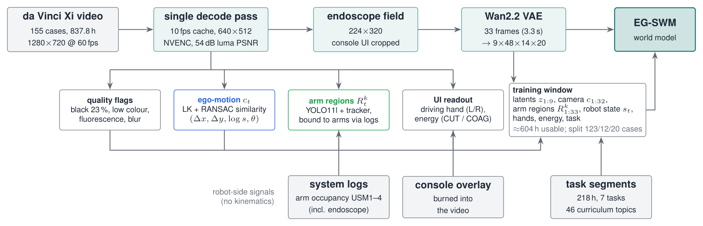
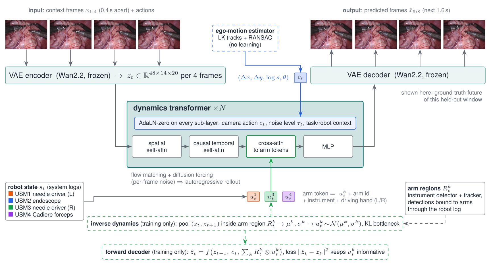

# Surgical World Model (EG-SWM)

**Embodiment-grounded world models of robot-assisted surgery.** Given a few endoscope frames and an action, the model predicts the next seconds of surgical video. Its action space mirrors the robot: an explicit **endoscope ego-motion** action plus one latent action per **instrument arm**, learned from unlabeled in-vivo da Vinci video and bound to the arms through the robot's own system logs — no kinematics needed. Target venue: *IEEE Transactions on Medical Robotics and Bionics*; early showcase at NBRCOM-2026 (AIIMS Nagpur).

* Weights (public, CC BY-NC-SA 4.0): <https://huggingface.co/GOVINDFROM/surgical-world-model>
* Research documents: [data audit](docs/01_data_audit.md) · [external data](docs/02_external_data.md) · [literature review](docs/03_literature_review.md) · [research plan](docs/04_research_plan.md) · [legacy](docs/legacy.md)

## Status (updated 2026-10-27, 05:00 IST)

| Stage | State |
|---|---|
| Data audit, literature review, hypotheses | done |
| Case-level split (123 / 12 / 20 cases) | done — `configs/splits/surgvu_v1.json` |
| Tokenizer selection | done — Wan2.2 VAE (table below) |
| SurgVU processing: 10 fps cache → Wan2.2 latents → instrument detection → arm binding → conditioning | running as a chained pipeline (cache 35 / 280 parts) |
| External data downloaded | JIGSAWS, SAR-RARP50, Open-H SutureBot + CRCD; SRT-H downloading |
| External data prepared into the same representation (latents, camera actions, arm regions, kinematics) | SutureBot running; CRCD and JIGSAWS queued |
| AutoLaparo | server unreachable from this network; auto-retry running |
| Model, baselines, training, evaluation code | done: EG-SWM + 6 action interfaces, kinematics-conditioned mode, SurgWM re-implementation |
| Experiments E1–E6 | pilot queued; controlled comparison next ([plan](docs/04_research_plan.md)) |
| Manuscript | draft skeleton in `paper/tmrb` (IEEEtran, method and setup written) |

## Experiments and evaluation protocol

| ID | Question | Data | Script |
|---|---|---|---|
| E1 | fidelity and controllability of each action interface at equal capacity | SurgVU, 2,000 fixed held-out windows from 20 test cases | `scripts/eval/eval_wm.py`, `scripts/eval/eval_control.py` |
| E2 | do learned per-arm actions encode real robot motion? | SutureBot, CRCD, JIGSAWS (held-out episodes / surgeons) | `scripts/eval/probe_kinematics.py` |
| E2b | does the explicit camera action measure real endoscope motion? | CRCD (ECM joints, camera pedal) | `scripts/eval/validate_camera_action.py` |
| E3 | kinematics-conditioned prediction, data efficiency of unlabeled pre-training | SutureBot, SRT-H, CRCD | `scripts/train/train_wm.py --action kin --init <run>` |
| E4 | transfer to clinical surgery | SAR-RARP50 | — |
| E6 | ablations (action structure, camera, grounding, bottleneck, tokenizer, data and model scale) | SurgVU | `scripts/train/train_wm.py` |

Metrics: PSNR / SSIM / LPIPS per predicted frame against **real** frames (not VAE reconstructions), FVD with the StyleGAN-V I3D port, ΔPSNR under swapped actions, endoscope compliance (commanded vs re-estimated motion), per-arm locality of action changes, embodiment consistency (instrument detector on generated frames vs the robot's logged instruments), and linear-probe R² against kinematics. Reference rows: repeat-last-context-frame and VAE reconstruction.

Compared action interfaces, all sharing tokenizer, backbone, data and budget: `none`, `state` (robot state only), `global` (monolithic continuous latent action, Genie-style), `global_vq` (12 discrete actions, SurgWM-style), `slots` (unsupervised factors, FLAM-style), `arms` (**EG-SWM**), each with or without the explicit camera action; plus the full SurgWM re-implementation and, on kinematic benchmarks, Cosmos-H-Surgical-Simulator.

## Overview

### Data pipeline



*One decode pass turns 837.8 h of 720p60 da Vinci video into a 10 fps cache (640×512, visually lossless) and, per frame, quality flags and the endoscope's ego-motion. Robot-side signals — the system logs' arm occupancy (which arm holds the endoscope and which instrument sits on every other arm) and the console overlay burned into the video (driving hand, energy) — bind detected instruments to robot arms. The world model sees only the 224×320 endoscope field, never the overlay, so it cannot read instrument names off the screen.*

### Model



*Sample input/output from a held-out test case (`case_139`, suturing; frames 0.4 s apart). Until the first model is trained, the output row shows the ground-truth future of that window; it will be replaced by model rollouts on the same window. Frames: SurgVU dataset (Zia et al., 2025), endoscope field only.*

**Tokenizer.** A frozen Wan2.2 video VAE compresses 4 frames into one latent $z_t\in\mathbb{R}^{48\times14\times20}$; a 3.3 s training window (33 frames at 10 fps) becomes 9 latents.

**Actions.** For each latent step the action is $a_t=(c_t,\{u^k_t\}_k)$:
* $c_t=(\Delta x,\Delta y,\log s,\theta)$ — endoscope ego-motion, *measured* (Lucas–Kanade tracks + RANSAC similarity, instruments rejected as outliers). It enters every transformer sub-layer through AdaLN.
* $u^k_t$ — a low-dimensional *learned* action for instrument arm $k$, produced during training by an inverse-dynamics head that only sees the latents inside that arm's region $R^k_t$ (instrument detector + tracker, detections bound to arms through the robot log) and is regularised by a KL bottleneck. Each arm becomes a token (action + arm id + instrument + driving hand) that the video tokens cross-attend to.

**Dynamics.** A latent spatio-temporal diffusion transformer (spatial self-attention per frame, causal temporal self-attention, cross-attention to arm tokens, MLP) trained with flow matching and per-frame noise levels (diffusion forcing), so it can roll out autoregressively from any number of context frames.

**Why.** A single latent action (Genie, SurgWM) has to explain camera motion, two or three instruments and tissue response at once; LAOM (ICML 2025) shows such latents collapse under action-correlated distractors unless a little supervision is added. The robot already tells us its embodiment for free — we use it to structure, not just supervise, the action space. Hypotheses H1–H4 and the experiment plan are in [docs/04_research_plan.md](docs/04_research_plan.md).

## Results so far

### Tokenizer selection (64 held-out validation clips × 9 frames, 224×320)

| Tokenizer | Type | Latent numbers / frame | PSNR ↑ | SSIM ↑ | LPIPS ↓ |
|---|---|---:|---:|---:|---:|
| FLUX.2 VAE | image, f8, 32 ch | 35,840 | **38.40** | **0.975** | **0.007** |
| **Wan2.2 VAE (chosen)** | video, f16, ×4 time, 48 ch | **4,480** | 34.44 | 0.947 | 0.019 |
| Wan2.1 VAE | video, f8, ×4 time, 16 ch | 5,973 | 34.13 | 0.947 | 0.020 |
| SD-VAE (ft-MSE) | image, f8, 4 ch | 4,480 | 28.85 | 0.829 | 0.057 |
| DC-AE | image, f32, 32 ch | 2,240 | 26.15 | 0.738 | 0.090 |

Wan2.2 gives the best quality per latent number (8× more compact than FLUX.2 at 34.4 dB, far above the PSNR any predicted frame reaches) and temporally coherent decoding; FLUX.2 is kept as the per-frame tokenizer ablation. Reproduce: `python scripts/eval/tokenizer_bench.py`.

### Data facts that shape the method ([full audit](docs/01_data_audit.md))

* 155 cases, 280 videos, 837.8 h, all decodable; ≈604 h usable (23 % black, 4.5 % out of body / smoke, 1.7 % fluorescence).
* The system logs record all four arms **including the endoscope**; the camera arm never changes within a case (USM2 in 142 cases, USM3 in 11). Three instruments are mounted 65 % of the time; 5,969 instrument exchanges (7.1 / h).
* Log times are part-relative (`swm.data.surgvu.timeline` handles offsets); 97 % of same-arm overlaps are stale intervals from missing uninstall events.
* The console overlay is present on 81 % of usable frames and shows which hand drives which arm and when energy fires.

## Datasets

| Dataset | Role | Access | Local status |
|---|---|---|---|
| SurgVU (Intuitive) | training + main benchmark | public | `data/raw/surgvu*` |
| Open-H-Embodiment: SutureBot, SRT-H porcine cholecystectomy, CRCD | kinematic grounding, kinematics-conditioned benchmarks | CC-BY-4.0 | downloading |
| JIGSAWS | kinematic grounding (da Vinci) | data-use agreement | downloaded |
| SAR-RARP50 | clinical (human) transfer | CC BY-NC-SA 4.0 | downloading |
| AutoLaparo | external test of the camera action (laparoscope motion labels) | request form | pending (server unreachable) |

PhysioNet holds no surgical video with robot kinematics, so nothing is taken from it ([details](docs/02_external_data.md)).

## Repository layout

```text
src/swm/                  package
  data/surgvu.py          robot-log labels on a global case timeline, arm occupancy, tasks
  data/windows.py         SurgVU latent windows (robot state, arm boxes, camera actions)
  data/external.py        external datasets with kinematics; data/kinematics.py per-arm motion
  models/                 ST-DiT dynamics, action interfaces (camera, arm tokens, inverse dynamics), world model
  baselines/surgwm.py     re-implementation of the Surgical Vision World Model
  metrics/                PSNR / SSIM / LPIPS, FVD
  data/geometry.py        crops shared by every stage (source -> cache -> endoscope field)
  data/egomotion.py       endoscope ego-motion (LK + RANSAC similarity)
  metrics/image.py        PSNR / SSIM / LPIPS
  hub.py                  Hugging Face upload (token from .env, never printed)
scripts/data/             audits, splits, downloads, cache builder
scripts/train/            world-model and SurgWM training
scripts/eval/             tokenizer benchmark, E1 fidelity/control, E2 probes, camera-action validation
scripts/queue/            sequential GPU job queue
scripts/docs/             sample export, TikZ diagram build
docs/                     research documents; docs/diagrams/*.tex -> docs/figures/*.{pdf,png}
configs/splits/           case-level splits
legacy/                   previous SurgVU 2026 Cat-1 detection project (reused detector)
data/ checkpoints/ outputs/ archive/   Git-ignored
```

## Setup and reproduction

```bash
uv venv --python 3.12 .venv
uv pip install --python .venv/bin/python torch torchvision --index-url https://download.pytorch.org/whl/cu130
uv pip install --python .venv/bin/python -e ".[dev]"

python scripts/data/audit_surgvu.py --workers 20          # video integrity, label tables
python scripts/data/audit_timeline.py                     # robot configuration on the global timeline
python scripts/data/audit_frames.py --every 60            # frame quality, console-UI presence
python scripts/data/make_splits.py                        # case-level split
python scripts/data/build_surgvu_cache.py --workers 10    # 10 fps cache + quality + ego-motion
python scripts/data/download_external.py --list           # external datasets
python scripts/eval/tokenizer_bench.py                    # tokenizer comparison
scripts/docs/build_diagrams.sh                            # TikZ -> PDF/PNG
```

Raw SurgVU data comes from the organisers (`storage.googleapis.com/isi-surgvu/…`); links for data-use-agreement datasets live in the Git-ignored `configs/private/dataset_links.json`. A `.env` with `hf=<token>` and `HF_USER=<user>` enables weight uploads.

## Citation of data

* A. Zia et al., "Surgical Visual Understanding (SurgVU) Dataset," arXiv:2501.09209, 2025.
* Y. Gao et al., "JHU-ISI Gesture and Skill Assessment Working Set (JIGSAWS): A Surgical Activity Dataset for Human Motion Modeling," MICCAI Workshop M2CAI, 2014 — <http://cirl.lcsr.jhu.edu/research/hmm/datasets/jigsaws_release>.
* Open-H-Embodiment Consortium, "Open-H-Embodiment: A Large-Scale Dataset for Enabling Foundation Models in Medical Robotics," arXiv:2604.21017, 2026.
* D. Psychogyios et al., "SAR-RARP50: Segmentation of surgical instrumentation and Action Recognition on Robot-Assisted Radical Prostatectomy Challenge," arXiv:2401.00496, 2023.
* Z. Wang et al., "AutoLaparo: A New Dataset of Integrated Multi-tasks for Image-guided Surgical Automation in Laparoscopic Hysterectomy," MICCAI 2022, arXiv:2208.02049.
* "Comprehensive Robotic Cholecystectomy Dataset (CRCD): Integrating Kinematics, Pedal Signals, and Endoscopic Videos," ISMR 2024, doi:10.1109/ISMR63436.2024.10585836.
